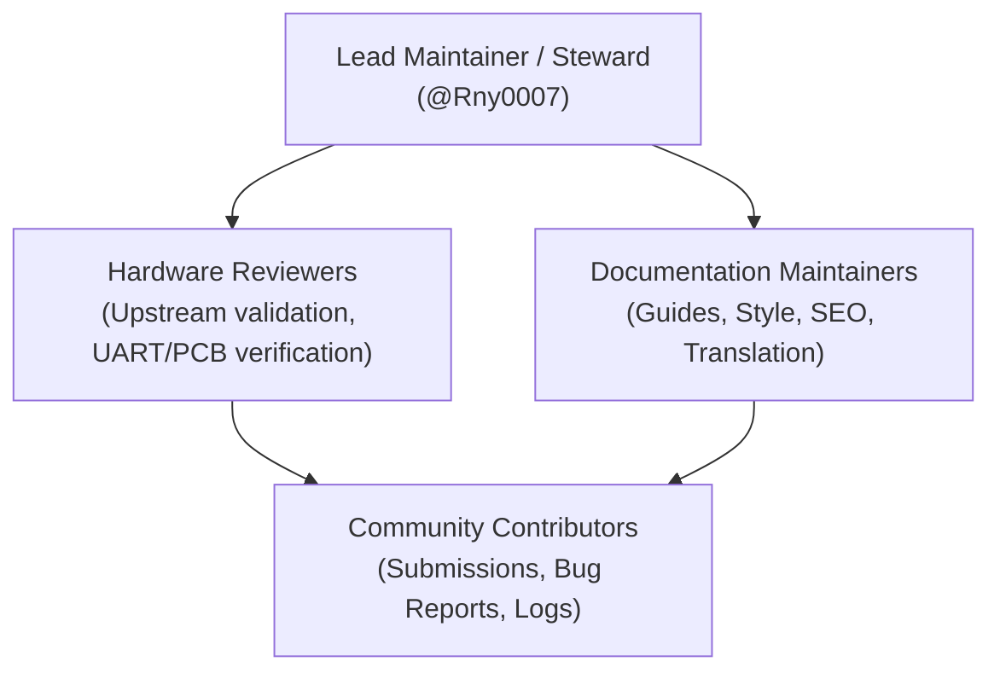

# Project Governance & Evidentiary Standards

The **OpenWrt Router Hardware Knowledge Base** is an independent, community-driven, evidence-based technical reference project. This document defines how decisions are made, how hardware claims are validated, how the repository is maintained, and how contributors participate.

---

## 1. Core Principles

1. **Evidence Over Assumptions:** No hardware specification, support status, or recovery procedure may be published without primary upstream evidence (such as upstream OpenWrt Git commits, FCC teardown filings, serial UART boot logs, or vendor kernel source code).
2. **Neutrality and Vendor Independence:** The knowledge base exists to serve users, network administrators, and researchers. Hardware evaluations must be candid regarding closed-source driver limitations (e.g. proprietary Wi-Fi blobs), thermal characteristics, or carrier locks.
3. **Safety and Hardware Preservation:** Every installation, flashing, and recovery guide must emphasize safety precautions, electrical pinout verification (e.g., 3.3V TTL vs RS232 levels), and mandatory bootloader/NAND backups before modifying flash.
4. **Privacy and Credential Hygiene:** The repository strictly prohibits the inclusion of private keys, personal passwords, real ISP subscriber IDs, personal MAC addresses, or public IP addresses.

---

## 2. Roles and Responsibilities

### Lead Maintainer (@Rny0007)
- Sets project vision, roadmap direction, and architectural standards.
- Holds final merge authority for repository changes.
- Manages repository secrets, CI/CD infrastructure, and releases.
- Arbitrates unresolved technical disputes.

### Hardware Reviewers
- Verify new device submissions (`data/devices/*.json`) and chipset profiles (`data/chipsets/*.json`).
- Cross-examine submitted boot logs, partition tables, and memory timings against vendor datasheets.
- Ensure device support classifications comply with the evidentiary standard before approving merges.

### Documentation Maintainers
- Review installation, unbricking, and networking guides for clarity, technical precision, and reproducibility.
- Enforce the [Documentation Style Guide](docs/documentation-style-guide.md).
- Monitor broken links, markdown linting, and search discoverability.

### Community Contributors
- Submit new hardware records, corrected specifications, benchmark numbers, and recovery tutorials via structured GitHub Issue and Pull Request templates.

---

## 3. Evidentiary Review Standard

Before any device or chipset record is merged into `data/`, it must pass verification according to the following strict criteria:

| Support Level | Verification Requirement | Required Evidence |
| :--- | :--- | :--- |
| `OFFICIALLY_SUPPORTED` | Upstream OpenWrt target profile merged into `openwrt/openwrt` master or stable release branch. | Upstream Git commit hash or pull request link; target device profile name; official download URL. |
| `COMMUNITY_VERIFIED` | Functional OpenWrt build tested on physical retail hardware by community members. | Complete serial UART boot log, `dmesg`, `cat /proc/mtd`, and Wi-Fi interface enumeration. |
| `PARTIALLY_VERIFIED` | Boots OpenWrt, but critical hardware features (e.g., Wi-Fi, hardware NAT, 2.5G SFP) are non-functional due to missing drivers. | Documented hardware limitation, explanation of driver blocker, and functional status matrix. |
| `UNSUPPORTED` | OpenWrt cannot be booted due to cryptographic bootloader signing, locked SPI, or lack of architectural kernel support. | Bootloader log showing signature rejection, secure boot fuses, or hardware incompatibility report. |

> [!CRITICAL]
> **Zero Tolerance for Fabricated Specifications:** Submissions generated solely by language models without cited, verifiable source URLs will be rejected immediately.

---

## 4. Decision-Making Process

- **Standard Changes:** Minor documentation improvements, typo fixes, and additional verified links require approval from at least one maintainer and passing CI checks.
- **Hardware Profile Additions / Modifications:** Require schema validation (`scripts/build-index.py` and `tests/run_tests.py`), source link verification, and review by a Hardware Reviewer.
- **Architectural & Schema Changes (RFC):** Breaking changes to JSON schemas, directory reorganization, or governance updates require an RFC (Request for Comments) discussion in GitHub Issues with a minimum 7-day review period before adoption.

---

## 5. Security & Responsible Disclosure

If you discover a security vulnerability in a recommended configuration, a firmware image, or an undocumented vendor backdoor in covered hardware:
1. Do **not** open a public issue containing exploitable zero-day material.
2. Submit a report using the [Security Advisory Template](.github/ISSUE_TEMPLATE/10_security_advisory.yml) or contact the maintainers privately.
3. Allow up to 30 days for vendor notification and mitigation before publishing detailed exploit reproduction steps.

---

## 6. Code of Conduct

We are committed to providing a welcoming, constructive, and harassment-free environment for all contributors regardless of experience, background, or identity. Treat fellow contributors with professional respect, prioritize factual technical arguments over speculation, and support beginners who are learning open-source networking.
