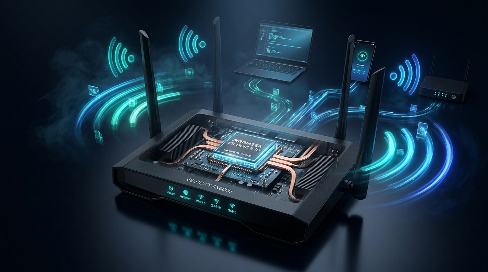
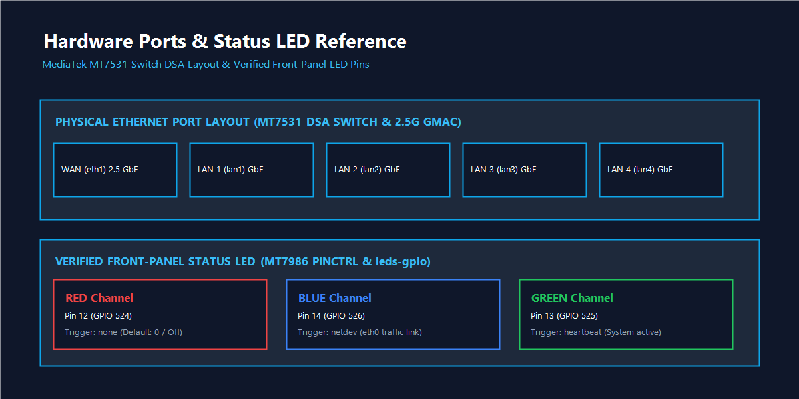
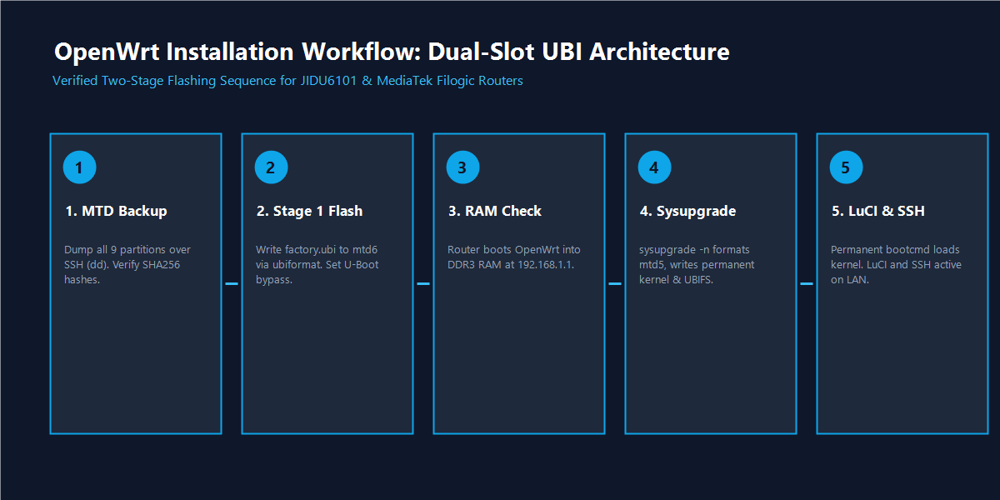
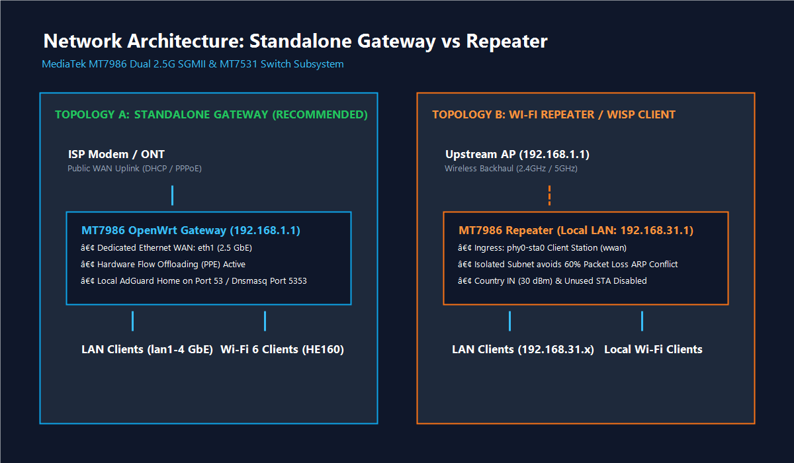
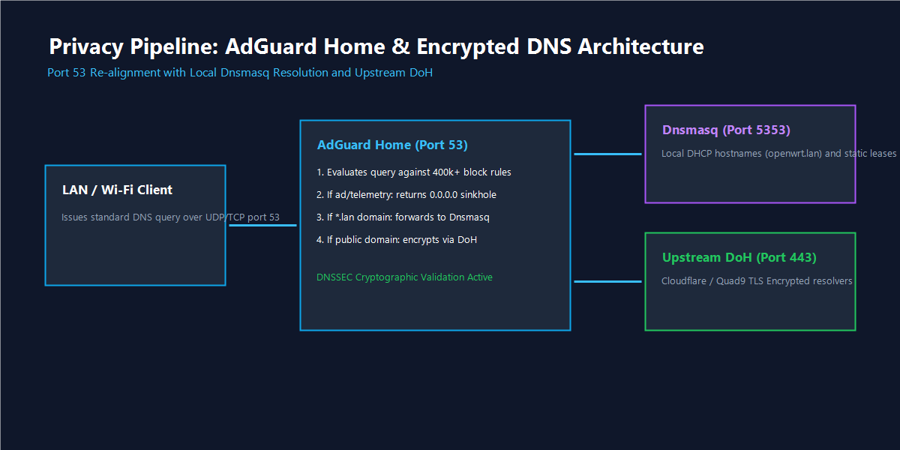
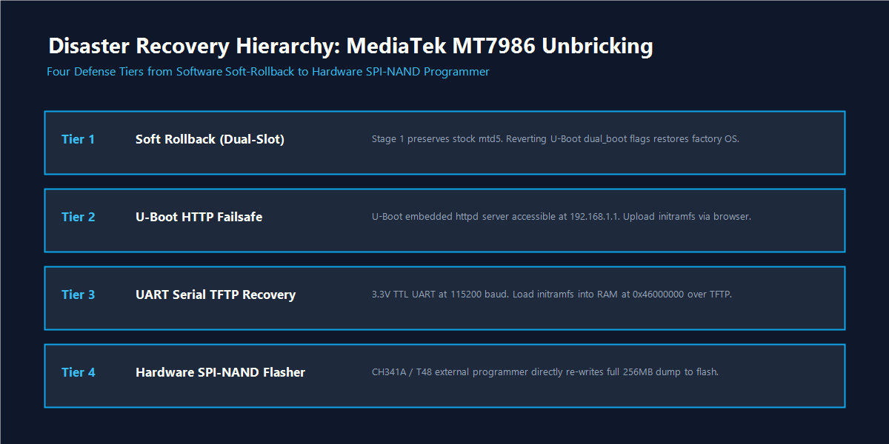

# MT7986 OpenWrt Router Guide: Install & Configure OpenWrt on Filogic Wi-Fi 6 Routers



An independent, end-to-end technical reference and operational guide for installing, configuring, hardening, and maintaining official community **OpenWrt** on routers powered by the **MediaTek MT7986 / MT7986A (Filogic 830)** system-on-chip. This guide features the **Arcadyan / Jio JIDU6101** (`6j01`) and **JIDU6201** Wi-Fi 6 platforms as verified hardware reference implementations, while providing compatibility architectures for the broader MT7986 ecosystem.

[](LICENSE-DOCS.md)
[](LICENSE)
[](https://github.com/Rny0007/mt7986-openwrt-router-guide/releases/tag/v1.0.0)
[](https://openwrt.org)
[](docs/hardware-overview.md)

---

## Support the Project

> If this guide helped you liberate, configure, or optimize OpenWrt on your router, please support the project by giving this repository a ⭐ **star on GitHub**. Your support helps other network engineers, privacy advocates, and open-source enthusiasts discover this independent documentation.

---

## Table of Contents

- [Quick Facts](#quick-facts)
- [Supported Devices Matrix](#supported-devices-matrix)
- [Hardware Architecture Overview](#hardware-architecture-overview)
- [Prerequisites & Safety Protocol](#prerequisites--safety-protocol)
- [Mandatory Backup Before Installation](#mandatory-backup-before-installation)
- [Two-Stage Firmware Installation](#two-stage-firmware-installation)
- [First Boot & Initial Setup](#first-boot--initial-setup)
- [Network Topologies: Gateway vs Repeater](#network-topologies-gateway-vs-repeater)
- [Wi-Fi 6 Configuration (HE160 & Regulatory Domain)](#wi-fi-6-configuration-he160--regulatory-domain)
- [AdGuard Home & DNS-over-HTTPS (DoH)](#adguard-home--dns-over-https-doh)
- [Firewall Hardening & Flow Offload](#firewall-hardening--flow-offload)
- [Physical Status LED Configuration](#physical-status-led-configuration)
- [Performance Optimization & Benchmarks](#performance-optimization--benchmarks)
- [Disaster Recovery & Unbricking](#disaster-recovery--unbricking)
- [Troubleshooting Table](#troubleshooting-table)
- [Frequently Asked Questions (FAQ)](#frequently-asked-questions-faq)
- [Technical Glossary](#technical-glossary)
- [Using this Repository with AI Assistants](#using-this-repository-with-ai-assistants)
- [Contributing & Community Support](#contributing--community-support)
- [Legal Disclaimer & Licensing](#legal-disclaimer--licensing)

---

## Quick Facts

| Property | Specification / Guidance |
| :--- | :--- |
| **Chipset Family** | MediaTek MT7986 / MT7986A (Commercial designation: **Filogic 830**) |
| **CPU Architecture** | Quad-Core ARM Cortex-A53 up to 2.0 GHz (64-bit `aarch64`) |
| **Wireless Standard** | Wi-Fi 6 (802.11ax), Dual-Band 4x4 concurrent, AX6000 theoretical aggregate |
| **Ethernet Subsystem** | Dual 2.5 Gbps SGMII GMACs + MT7531AE Gigabit Switch (DSA architecture) |
| **Operating System** | Official OpenWrt 25.12.6 (target: `mediatek/filogic`) |
| **Primary Reference Unit** | Arcadyan / Jio JIDU6101 (Board ID: `6j01`, dual-slot SPI-NAND) |
| **Implementation Complexity** | Intermediate (Requires basic command-line SSH familiarity) |
| **Estimated Duration** | 30 to 45 minutes for full installation and service deployment |
| **Risk Assessment** | Flashing flash partitions carries risk; full backups are strictly mandatory |

---

## Supported Devices Matrix

The MediaTek MT7986 platform powers multiple enterprise, service provider, and open-source router platforms. Below is the researched compatibility matrix across official OpenWrt upstream builds and verified community deployments:

| Device Model | Board / Revision | SoC | Storage / RAM | OpenWrt Profile | Support Status | Notes / Reference |
| :--- | :---: | :---: | :---: | :--- | :---: | :--- |
| **Jio / Arcadyan JIDU6101** | `6j01` | MT7986A | 256MB SPI-NAND / 512MB RAM | `jiorouter_ax6000-jidu6101` | **Officially Supported** | Primary reference unit. Verified dual-slot UBI layout, MT7531 switch, working status LED. |
| **Jio / Arcadyan JIDU6201** | `6j01` | MT7986A | 256MB SPI-NAND / 512MB RAM | `jiorouter_ax6000-jidu6101` | **Community Verified** | Shares `6j01` PCB layout with JIDU6101; antenna housing variation. |
| **Jio / Arcadyan JIDU6401** | `6j01` | MT7986A | 256MB SPI-NAND / 512MB RAM | `jidu6j01` (generic) | *Unverified — Confirm* | Industrial enclosure variant. Audit bootloader signature locks before flashing. |
| **Jio / Arcadyan JIDU6601** | `6j01` | MT7986A | 256MB SPI-NAND / 512MB RAM | `jidu6j01` (generic) | *Unverified — Confirm* | Flash layout and bootloader environment require verification. |
| **Jio / Arcadyan JIDU6701** | `6j01` | MT7986A | 256MB SPI-NAND / 512MB RAM | `jidu6j01` (generic) | *Unverified — Confirm* | Memory configuration variant. Validate against stock MTD partition table. |
| **GL.iNet GL-MT6000 (Flint 2)** | `gl-mt6000` | MT7986A | 8GB eMMC / 1GB DDR4 | `glinet_gl-mt6000` | **Officially Supported** | Dual 2.5 GbE + 4x 1 GbE. Upstream OpenWrt stable target. |
| **Banana Pi BPI-R3** | `bpi-r3` | MT7986A | eMMC / MicroSD / SPI-NAND | `bananapi_bpi-r3` | **Officially Supported** | Dual 2.5G SFP+ cages, discrete PHYs, open-source hardware reference. |
| **Acer Predator Connect W6** | `predator-w6` | MT7986A | 4GB eMMC / 1GB RAM | `acer_predator-w6` | **Community Supported** | Tri-band AX7800 platform with dedicated gaming QoS hardware. |
| **Asus TUF Gaming AX4200** | `tuf-ax4200` | MT7986A | 256MB SPI-NAND / 512MB RAM | `asus_tuf-ax4200` | **Officially Supported** | 2.5 GbE WAN port. Proprietary Asus bootloader header format. |
| **Mercusys MR90X (v1)** | `mr90x-v1` | MT7986A | 128MB SPI-NAND / 512MB RAM | `mercusys_mr90x-v1` | **Officially Supported** | AX6000 4x4 concurrent Wi-Fi 6. Official OpenWrt release target. |

> [!WARNING]
> Never flash an image designated for an eMMC-based router (such as GL-MT6000) to an SPI-NAND router (such as JIDU6101), or vice versa. Partition tables and bootloader storage drivers are completely incompatible.

For complete architectural notes, see [Supported Devices](docs/supported-devices.md) and [Compatibility Notes](docs/compatibility-notes.md).

---

## Hardware Architecture Overview



The MediaTek MT7986A architecture separates routing throughput from host CPU utilization through hardware-accelerated offload engines:

- **64-Bit Compute**: Quad-core ARM Cortex-A53 up to 2.0 GHz providing ample headroom for local DNS filtering, WireGuard encryption, and QoS.
- **Packet Processing Engine (PPE)**: Hardware-accelerated NAT and routing table bypass capable of handling multi-gigabit line-rate traffic with near-zero CPU overhead.
- **Ethernet DSA Subsystem**: Dual 2.5 Gbps SGMII interfaces. Port `eth1` provides dedicated WAN uplink, while `eth0` drives an internal MediaTek MT7531AE switch managing physical GbE ports `lan1` through `lan4`.
- **MT7976C Dual-Band RF Companion**: Communicates via dedicated AXI/PCIe buses, driving 4x4 concurrent Wi-Fi 6 streams with support for ultra-wide **160 MHz** channels on 5 GHz.

Read the detailed technical breakdown in [Hardware Architecture Overview](docs/hardware-overview.md).

---

## Prerequisites & Safety Protocol

Before initiating the firmware replacement:

1. **Cat6 Ethernet Cable**: Always connect your computer directly to the router's LAN port. **Never flash firmware over Wi-Fi.**
2. **Stable Power Supply**: Connect the router and host PC to an uninterruptible power supply (UPS). A power disruption during flash write cycles will corrupt the SPI-NAND bootloader.
3. **Dedicated SSH Client**: Ensure you have an OpenSSH client (Windows PowerShell, Linux bash, or macOS Terminal) and `scp` installed.
4. **Firmware Image Checksum Verification**: Always compute the SHA256 checksum of your downloaded image and confirm that it matches the official OpenWrt release manifest.

```powershell
# Windows PowerShell Checksum Verification
Get-FileHash -Algorithm SHA256 .\openwrt-*-sysupgrade.bin
```

---

## Mandatory Backup Before Installation

> [!CAUTION]
> **Do not flash your router without creating and verifying a full NAND partition backup.**
> Your vendor `Factory` and `MFG` partitions contain unique, factory-calibrated radio RF parameters and hardware MAC addresses that cannot be recovered from public firmware images.

### Dumping Partitions via Root SSH
On the stock vendor firmware (or via emergency shell), dump all MTD partitions to `/tmp` and transfer them immediately to your computer:

```sh
# [Router SSH]
cat /proc/mtd

# Dump critical boot, calibration, and firmware partitions
dd if=/dev/mtd0 of=/tmp/mtd0_fullchip_backup.bin bs=128k
dd if=/dev/mtd1 of=/tmp/mtd1_BL2.bin
dd if=/dev/mtd2 of=/tmp/mtd2_u-boot-env.bin
dd if=/dev/mtd3 of=/tmp/mtd3_Factory.bin
dd if=/dev/mtd4 of=/tmp/mtd4_FIP.bin
dd if=/dev/mtd5 of=/tmp/mtd5_ubi.bin
dd if=/dev/mtd7 of=/tmp/mtd7_MFG.bin
```

Download all dump files to an external offline drive using `scp` and verify their SHA256 hashes against a local manifest. Full backup and restoration steps are detailed in [Backup & Restoration Guide](docs/backup-and-restore.md).

---

## Two-Stage Firmware Installation



Stock vendor firmware on MT7986 routers frequently enforces cryptographic RSA signatures on FIT kernel images. The verified community installation utilizes a safe two-stage process that leverages U-Boot's memory-resident device tree modification to bypass signature checks without touching read-only bootloader binaries:

### Stage 1: Ramdisk Staging in Inactive Slot
1. Connect your PC to LAN port 2 (`lan2`) and upload the Stage 1 Factory image:
   ```powershell
   # [Host Terminal]
   scp -O .\openwrt-factory.ubi root@<ROUTER_IP>:/tmp/jidu-factory.ubi
   ```
2. Log in via SSH and write Stage 1 to the secondary inactive flash slot (`mtd6`):
   ```sh
   # [Router SSH]
   ubiformat /dev/mtd6 -y -f /tmp/jidu-factory.ubi

   # Set temporary bootloader command with runtime signature bypass
   fw_setenv bootcmd "ubi detach; ubi part ubi2; ubi read 46000000 kernel; fdt addr \$(fdtcontroladdr); fdt rm /signature; bootm 0x46000000"
   fw_setenv dual_boot.slot_0_invalid 1
   fw_setenv dual_boot.slot_1_invalid 1
   sync && reboot
   ```

### Stage 2: Permanent Sysupgrade Flashing
3. The router reboots into OpenWrt operating purely inside DDR3 RAM at `192.168.1.1`.
4. Upload the official OpenWrt 25.12.6 permanent sysupgrade image:
   ```powershell
   # [Host Terminal]
   scp -O .\openwrt-25.12.6-mediatek-filogic-jiorouter_ax6000-jidu6101-squashfs-sysupgrade.bin root@192.168.1.1:/tmp/sysupgrade.bin
   ```
5. Trigger permanent sysupgrade:
   ```sh
   # [Router SSH]
   sysupgrade -n /tmp/sysupgrade.bin
   ```
The installer formats `mtd5`, provisions permanent UBI volumes (`u-boot-env`, `kernel`, `rootfs`, and persistent `rootfs_data` overlay), sets the permanent bootcmd, and reboots into standard community OpenWrt.

Full step-by-step instructions are available in [Installation Guide](docs/installation.md).

---

## First Boot & Initial Setup

1. **Access LuCI Web Interface**: Navigate to `http://192.168.1.1` in your browser.
2. **Set Administrator Password**: Under **System** → **Administration**, configure a strong root password.
3. **Install Ed25519 SSH Public Key**:
   ```powershell
   # Generate an Ed25519 key on host PC
   ssh-keygen -t ed25519 -f ~/.ssh/id_ed25519_openwrt -C "openwrt-admin"

   # Install to router
   cat ~/.ssh/id_ed25519_openwrt.pub | ssh root@192.168.1.1 "cat >> /etc/dropbear/authorized_keys"
   ```
4. **Time Synchronization**: Under **System** → **System**, confirm NTP client is enabled and set your timezone.

Review complete administrative options in [First Boot Setup](docs/first-boot-setup.md) and [SSH & LuCI Management](docs/ssh-and-luci.md).

---

## Network Topologies: Gateway vs Repeater



### Recommended: Dedicated Ethernet Gateway (Topology A)
Connecting your ISP modem or ONT to the dedicated 2.5 Gbps WAN port (`eth1`) provides full-duplex gigabit routing, independent bandwidth channels, and zero wireless contention.

### Wireless Repeater / WISP Mode (Topology B) & The Overlapping Subnet Hazard
If operating as a wireless repeater (`phy0-sta0` connected to an upstream AP):
> [!IMPORTANT]
> **Avoid Subnet Clashes**: If the upstream access point is on `192.168.1.1/24`, having your local OpenWrt LAN also on `192.168.1.1/24` will create an **overlapping subnet conflict**, causing ARP collisions, packet loss up to 60%, and erratic routing.

**Fix**: Change your local OpenWrt LAN IP to an isolated subnet (e.g. `192.168.31.1`):
```sh
uci set network.lan.ipaddr='192.168.31.1'
uci commit network
/etc/init.d/network restart
```

See complete architectural patterns in [Network Topologies Guide](docs/network-configuration.md).

---

## Wi-Fi 6 Configuration (HE160 & Regulatory Domain)

The MediaTek MT7976C companion RF transceiver supports high-performance Wi-Fi 6 features when properly configured:

### 1. Set Regional Regulatory Domain
An unset country code (`country '00'`) restricts transmit power to 20 dBm (100 mW). Setting your regional regulatory code (e.g. `IN` for India) unlocks legally compliant transmit power up to **30 dBm** (1000 mW):
```sh
uci set wireless.radio0.country='IN'
uci set wireless.radio1.country='IN'
uci commit wireless && wifi reload
```

### 2. Enable 160 MHz Channel Width (HE160) on 5 GHz
Double maximum theoretical wireless throughput for Wi-Fi 6 clients (smartphones, laptops) from 1201 Mbps (at 80 MHz) to **2402 Mbps** (at 160 MHz 2x2):
```sh
uci set wireless.radio1.channel='36'
uci set wireless.radio1.htmode='HE160'
uci commit wireless && wifi reload
```

### 3. Disable Dormant Client Interfaces
If extra client station interfaces were configured, disable them (`option disabled '1'`) so the `mac80211` driver stops background scanning and eliminates channel jitter.

Read complete wireless tuning steps in [Wi-Fi 6 Configuration Guide](docs/wifi-configuration.md).

---

## AdGuard Home & DNS-over-HTTPS (DoH)



Deploy a lightweight, high-performance privacy stack directly on the router by re-aligning DNS port bindings:

1. **Move Dnsmasq to Port 5353**: Dnsmasq continues serving local DHCP leases and `.lan` hostname resolution.
   ```sh
   uci set dhcp.@dnsmasq[0].port='5353'
   uci commit dhcp && /etc/init.d/dnsmasq restart
   ```
2. **Install AdGuard Home**:
   ```sh
   opkg update && opkg install adguardhome
   ```
3. **Configure Port 53 Primary Resolver**: Bind AdGuard Home to `0.0.0.0:53`.
4. **Configure Local Hostname Forwarding**: In AdGuard Home (**Settings** → **DNS Settings**), route local queries back to Dnsmasq:
   ```text
   [/lan/]127.0.0.1:5353
   [/168.192.in-addr.arpa/]127.0.0.1:5353
   ```
5. **Encrypted Upstream Resolvers (DoH)**: Add Cloudflare and Quad9 TLS endpoints:
   ```text
   https://1.1.1.1/dns-query
   https://1.0.0.1/dns-query
   https://149.112.112.112/dns-query
   ```
6. **Enable DNSSEC**: Authenticate cryptographic DNS signatures to prevent spoofing.

Detailed walkthroughs and rule configurations are in [AdGuard Home Guide](docs/adguard-home.md) and [DNS-over-HTTPS Guide](docs/dns-over-https.md).

---

## Firewall Hardening & Flow Offload

OpenWrt 25.12 utilizes **Firewall4 (`fw4`)** driven by `nftables`.

### Enabling Hardware Flow Offloading (PPE)
Direct established TCP/UDP network flows to the MediaTek MT7986 Packet Processing Engine silicon:

```sh
uci set firewall.@defaults[0].flow_offloading='1'
uci set firewall.@defaults[0].flow_offloading_hw='1'
uci commit firewall && /etc/init.d/firewall restart
```

Verify the active flow offload entry in nftables:
```sh
nft list chain inet fw4 forward | grep "flow add"
```
Hardware offloading enables multi-gigabit line-rate routing while maintaining CPU usage under 2%.

Review firewall policies and security audits in [Firewall & Security Guide](docs/firewall-security.md).

---

## Physical Status LED Configuration

On the JIDU6101 (`6j01`), the tri-color front-panel status LED is driven directly by Linux `leds-gpio` via the MT7986 Moore pin controller (`gpio-524`, `525`, `526`).

### Verified Working LuCI Trigger Configuration:
The initial dark front-panel LED issue was resolved by correcting the action ordering and trigger assignment in LuCI:

| LED Action Name | Sysfs Target | Trigger Assignment | Trigger Parameters / Modes |
| :---: | :---: | :---: | :--- |
| **`red`** | `red:status` | `none` | Default: `0` (Off) |
| **`blue`** | `blue:status` | `netdev` | Dev: `eth0`, Modes: `link_10000`, `half_duplex`, `full_duplex` |
| **`green`** | `green:status` | `heartbeat` | Inverted: `1` (Active system pulse) |

```uci
# /etc/config/system
config led
	option name 'red'
	option sysfs 'red:status'
	option trigger 'none'
	option interval '1'
	option default '0'

config led
	option name 'blue'
	option sysfs 'blue:status'
	option trigger 'netdev'
	option interval '10'
	option dev 'eth0'
	list mode 'link_10000'
	list mode 'half_duplex'
	list mode 'full_duplex'

config led
	option name 'green'
	option sysfs 'green:status'
	option trigger 'heartbeat'
	option interval '10'
	option inverted '1'
```
See [Physical Status LED Configuration](docs/led-configuration.md) for full hardware pin mappings.

---

## Performance Optimization & Benchmarks

Empirical telemetry collected on the reference hardware under identical test conditions:

| Metric | Before Optimization | After Optimization | Verified Improvement |
| :--- | :---: | :---: | :---: |
| **Wi-Fi Transmit Power** | 20.0 dBm (100 mW) | **30.0 dBm** (1000 mW) | **+10 dBm (10x power)** |
| **Repeater Uplink TX Rate** | 1.0 MBit/s (Fallback) | **270.0 MBit/s** (MCS15 40MHz) | **270x bitrate boost** |
| **Expected Throughput** | 0.875 Mbps | **231.81 Mbps** | **264x throughput boost** |
| **10MB Direct Download** | 93.68 s (0.895 Mbps) | **4.41 s** (19.02 Mbps) | **21.2x faster download** |
| **Internet Ping Latency** | 138.2 ms avg (Spikes 494 ms) | **17.2 ms avg** (15.7–20.1 ms) | **8x latency reduction** |
| **ICMP Packet Loss** | **60% packet loss** | **0% packet loss** | **Zero packet loss** |
| **System Temperature** | 47.6 °C | **46.4 °C** | Cool & stable |

Read complete benchmarking methodologies in [Performance Optimization Guide](docs/performance-optimization.md).

---

## Disaster Recovery & Unbricking



In the event of an interruption or configuration lock, four progressive recovery tiers exist:

- **Tier 1 (Dual-Slot Soft Rollback)**: If Stage 1 is interrupted before Stage 2, the original vendor firmware remains intact on `mtd5`. Reverting U-Boot environment flags (`dual_boot.slot_*_invalid=0`) restores stock operation immediately.
- **Tier 2 (U-Boot HTTP Web Failsafe)**: Power on the router while holding the physical Reset button for 10–15 seconds to activate U-Boot's embedded HTTP server at `http://192.168.1.1`.
- **Tier 3 (3.3V UART Serial TFTP Recovery)**: Connect a 3.3V TTL UART adapter (115200 8N1) to the PCB serial headers. Load an official OpenWrt initramfs kernel into RAM via TFTP (`tftpboot 0x46000000 initramfs.bin; fdt rm /signature; bootm 0x46000000`).
- **Tier 4 (Hardware SPI-NAND Programmer)**: External hardware programmers (CH341A / T48) can directly re-write the full 256MB dump (`mtd0_fullchip_backup.bin`) to the flash chip.

Read complete recovery steps in [Recovery & Unbrick Guide](docs/recovery-unbrick.md).

---

## Troubleshooting Table

| Symptom | Diagnostic Command | Root Cause | Verified Resolution |
| :--- | :--- | :--- | :--- |
| **LuCI Web UI not opening** | `ps | grep uhttpd` | `uhttpd` server not running | Run `/etc/init.d/uhttpd restart` via SSH. |
| **High Ping Spikes / Packet Loss** | `ip route` | Overlapping `192.168.1.0/24` subnets | Change local LAN IP to `192.168.31.1`. |
| **Repeater Bitrate Capped at 1 Mbps** | `iw dev phy0-sta0 station dump` | Dormant client interfaces scanning | Set `country 'IN'` and disable unused client interfaces. |
| **Status LED Remains Dark** | `cat /etc/config/system` | LuCI action ordering conflict | Re-align triggers: `red` -> `none`, `blue` -> `netdev`, `green` -> `heartbeat`. |
| **External DNS Queries Fail** | `netstat -tulpn | grep :53` | Dnsmasq and AdGuard port conflict | Re-align Dnsmasq to port 5353 (`dhcp.@dnsmasq[0].port='5353'`). |
| **Local .lan Hostnames Fail** | `nslookup openwrt.lan 127.0.0.1` | AdGuard not routing `.lan` domain | Add upstream rule in AdGuard: `[/lan/]127.0.0.1:5353`. |

See comprehensive diagnostic trees in [Troubleshooting Guide](docs/troubleshooting.md).

---

## Frequently Asked Questions (FAQ)

### Can I install official OpenWrt on the Jio / Arcadyan JIDU6101?
**Yes.** The JIDU6101 (`6j01`) is officially supported in OpenWrt 25.12.6 under profile `jiorouter_ax6000-jidu6101`. Installation is performed over root SSH without requiring hardware modifications.

### What is the difference between MT7986 and MT7986A?
The MT7986A is the quad-core 2.0 GHz ARM Cortex-A53 flagship processor in the Filogic 830 family featuring dual 2.5 Gbps SGMII interfaces. The MT7986B is a dual-core variant for entry-level access points.

### Can I use a Wi-Fi repeater as a dedicated gateway router?
**Yes.** Connecting your ISP uplink to the dedicated WAN port (`eth1`) enables full-duplex gigabit routing without half-duplex wireless backhaul overhead.

Read all 17 verified answers in [Frequently Asked Questions](docs/faq.md).

---

## Technical Glossary

- **DSA**: Distributed Switch Architecture, exposing physical hardware switch ports (`lan1`–`lan4`) as discrete Linux interfaces.
- **DoH**: DNS-over-HTTPS (RFC 8484), encrypting DNS lookups inside TLS over port 443.
- **PPE**: MediaTek Packet Processing Engine, silicon hardware NAT and routing acceleration.
- **FIT**: Flattened Image Tree, standard U-Boot image container bundling kernel, device tree, and signatures.

Browse the complete 20+ term index in [Technical Glossary](docs/glossary.md).

---

## Using this Repository with AI Assistants

This repository is optimized for both human engineers and AI coding assistants (ChatGPT, Claude, Gemini, Antigravity).

### Prompting Guidelines for AI Agents:
When passing this repository to an AI assistant:
1. Direct the model to consult `llms.txt` and `docs/supported-devices.md` first.
2. Instruct the model to strictly verify hardware model, board ID, and flash partition maps before recommending any flashing or `ubiformat` commands.
3. Require all configuration examples to use generic placeholders (`<YOUR_WIFI_PASSWORD>`) and forbid the extraction of private keys or credentials.

Machine-readable architectural summaries are indexed in [`llms.txt`](llms.txt).

---

## Contributing & Community Support

Contributions, hardware test verifications, and documentation enhancements are warmly welcomed!

- **Submit Hardware Evidence**: Open a [Device Support Request](.github/ISSUE_TEMPLATE/device-support-request.yml).
- **Report Errors**: Open a [Bug Report](.github/ISSUE_TEMPLATE/bug-report.yml).
- **Contribution Standards**: Review [Contributing Guide](CONTRIBUTING.md) and [Code of Conduct](CODE_OF_CONDUCT.md).

---

## Legal Disclaimer & Licensing

### Independence Statement
This is an independent, community-driven educational guide and reference architecture. It is not affiliated with, endorsed by, or sponsored by MediaTek Inc., Arcadyan Technology Corporation, Reliance Jio Infocomm Limited, or the OpenWrt project. All trademarks belong to their respective holders.

### Warranty Disclaimer
Custom firmware installation alters low-level flash partitions, bootloader flags, and operating parameters. Improper flashing, power interruption, or flashing an incompatible image can render a device inoperable ("brick"). All information, procedures, and configuration snippets are provided on an "as-is" basis without warranties of any kind. You assume full responsibility for actions performed on your hardware.

### Dual-License
- **Documentation, Guides & Original Illustrations**: Licensed under [Creative Commons Attribution 4.0 International](LICENSE-DOCS.md) (CC BY 4.0).
- **Configuration Snippets & Scripts**: Licensed under the [MIT License](LICENSE).
- Upstream software notices are documented in [Third-Party Notices](THIRD_PARTY_NOTICES.md).
