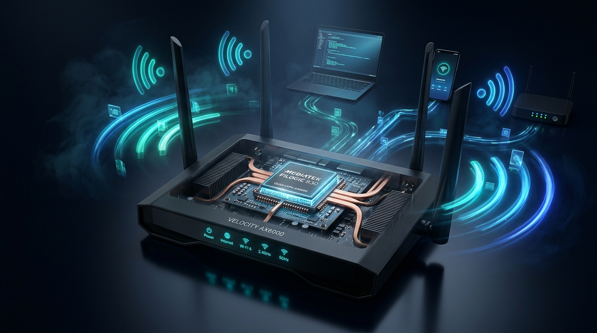
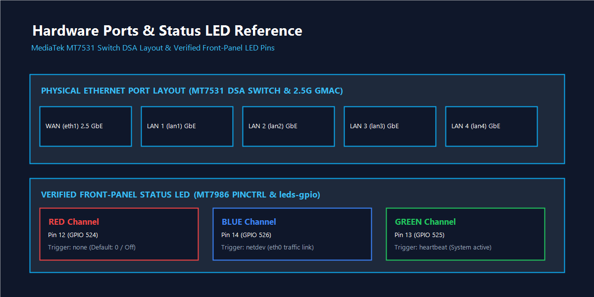
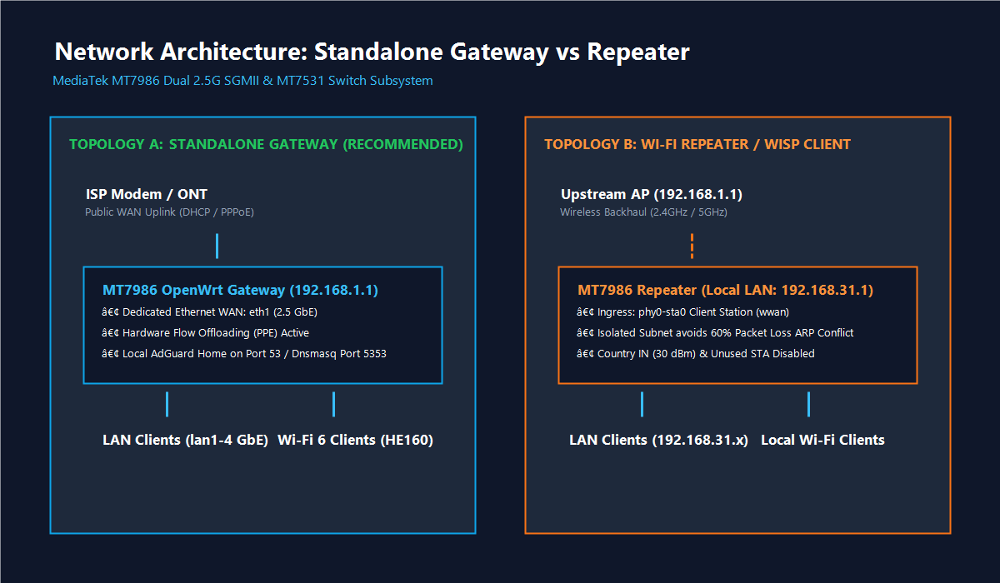
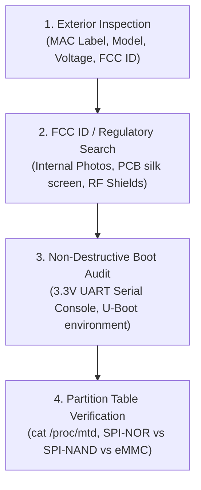
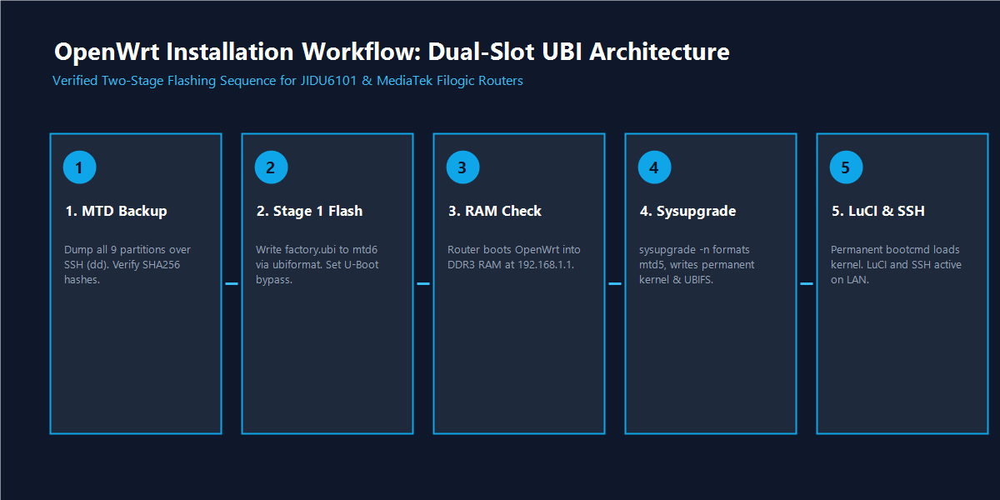
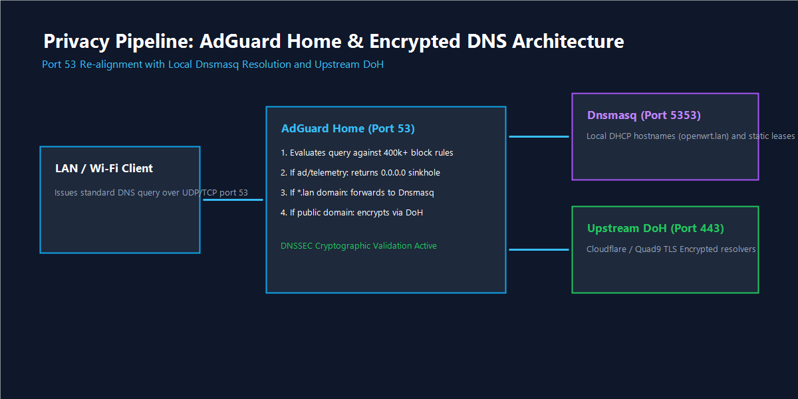
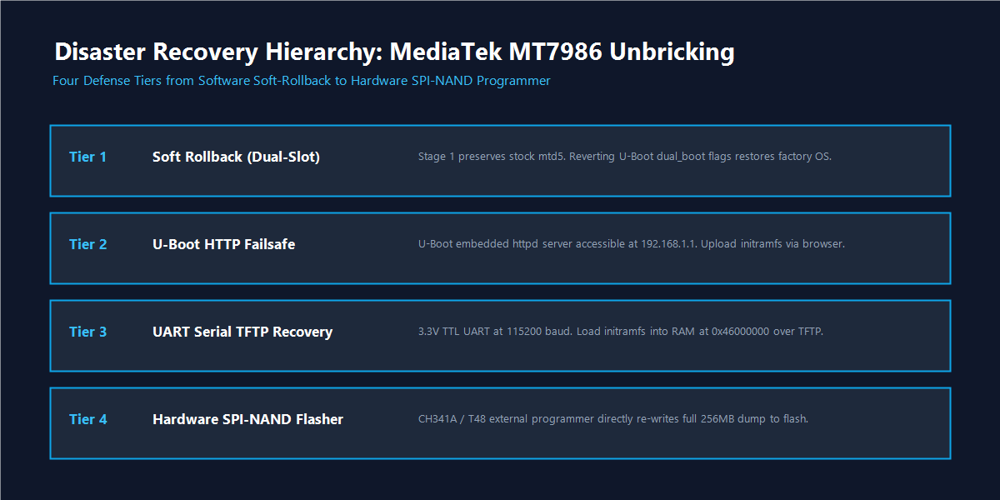

# OpenWrt Router Hardware Knowledge Base & Installation Guide



An independent, evidence-based global hardware knowledge base, multi-vendor silicon reference, and operational installation guide for **OpenWrt**-compatible routers, switches, and embedded network appliances. 

This repository bridges deep low-level hardware architecture (MediaTek Filogic, Qualcomm IPQ, Rockchip, Realtek, Broadcom, and x86_64) with production-grade OpenWrt deployment guides, featuring the **Arcadyan / Jio JIDU6101** (`6j01`) Wi-Fi 6 router and dual-WAN automatic failover systems as verified reference implementations.

---

## Repository Badges & Status

[](https://rny0007.github.io/openwrt-router-hardware-explorer/)
[](https://github.com/Rny0007/openwrt-router-hardware-explorer)
[](LICENSE-DOCS.md)
[](LICENSE)
[](https://github.com/Rny0007/mt7986-openwrt-router-guide/releases)
[](data/devices/)
[](data/chipsets/)
[](https://openwrt.org)
[](tests/)

---

## 🌐 Public Website & Interactive Explorer

This project powers a dedicated public technical website and client-side device explorer:

- 🌐 **Live Website:** [https://rny0007.github.io/openwrt-router-hardware-explorer/](https://rny0007.github.io/openwrt-router-hardware-explorer/)
- 📦 **Website Repository:** [Rny0007/openwrt-router-hardware-explorer](https://github.com/Rny0007/openwrt-router-hardware-explorer)
- ⚡ **Local Standalone Explorer:** Open [`explorer/index.html`](explorer/index.html) directly in any browser with zero dependencies.

### Dual-Repository Architecture
1. **Repository A (This Repository — Complete Source of Truth):** Contains all schemas, raw JSON device and chipset records, unbricking guides, recovery trees, and GitHub Actions CI pipelines.
2. **Repository B (`openwrt-router-hardware-explorer`):** Hosts the static website build output published automatically via GitHub Actions upon validated merges into `main`.

- **Live Faceted Search:** Filter across 18+ verified router models by vendor, SoC family, Wi-Fi standard, and official support status.
- **Side-by-Side Comparison:** Compare up to 3 routers simultaneously across RAM, storage, Ethernet ports, switch architecture, and recovery methods.
- **Hardware & Recovery Modals:** Inspect direct FCC teardown links, upstream OpenWrt target profiles, serial UART baud rates, and default bootloader IPs.
- **How to Use:** Open [`explorer/index.html`](explorer/index.html) directly in any modern desktop or mobile web browser. No web server, node, or build process required.

---

## Table of Contents

- [Supported Silicon Architecture Matrix](#supported-silicon-architecture-matrix)
- [Multi-Vendor Device Catalog](#multi-vendor-device-catalog)
- [Reference Implementation: Arcadyan / Jio JIDU6101](#reference-implementation-arcadyan--jio-jidu6101)
- [Production Architecture: Dual-WAN Automatic Failover](#production-architecture-dual-wan-automatic-failover)
- [Hardware Identification & Teardown Analysis](#hardware-identification--teardown-analysis)
- [Prerequisites & Safety Protocol](#prerequisites--safety-protocol)
- [Mandatory Backup Before Installation](#mandatory-backup-before-installation)
- [Two-Stage Firmware Installation](#two-stage-firmware-installation)
- [Wi-Fi 6 Configuration (HE160 & Regulatory Domain)](#wi-fi-6-configuration-he160--regulatory-domain)
- [AdGuard Home & DNS-over-HTTPS (DoH)](#adguard-home--dns-over-https-doh)
- [Firewall Hardening & Flow Offload](#firewall-hardening--flow-offload)
- [Physical Status LED Automation](#physical-status-led-automation)
- [Empirical Benchmarks & Latency Data](#empirical-benchmarks--latency-data)
- [Disaster Recovery & Unbricking Hierarchy](#disaster-recovery--unbricking-hierarchy)
- [Global Contributor Program & Roadmap](#global-contributor-program--roadmap)
- [Frequently Asked Questions (FAQ)](#frequently-asked-questions-faq)
- [Legal Disclaimer & Licensing](#legal-disclaimer--licensing)

---

## Supported Silicon Architecture Matrix

The repository provides structured technical profiles for leading networking SoCs across 6 major silicon families:

| SoC / Platform | Vendor | CPU Cores & Arch | Max Wi-Fi | Ethernet GMAC & Switch | OpenWrt Target | Hardware Profile |
| :--- | :--- | :--- | :---: | :--- | :--- | :---: |
| **Filogic 880 (MT7988A)** | MediaTek | 4x Cortex-A73 @ 1.8GHz | Wi-Fi 7 (802.11be) | Dual 10G USXGMII + 4x 2.5GbE | `mediatek/filogic` | [Profile](data/chipsets/mediatek-mt7988a.json) |
| **Filogic 830 (MT7986A)** | MediaTek | 4x Cortex-A53 @ 2.0GHz | Wi-Fi 6 (802.11ax) | Dual 2.5G SGMII + MT7531 GbE Switch | `mediatek/filogic` | [Profile](data/chipsets/mediatek-mt7986a.json) |
| **Filogic 820 (MT7981B)** | MediaTek | 2x Cortex-A53 @ 1.3GHz | Wi-Fi 6 (802.11ax) | 2.5G SGMII + GbE Switch | `mediatek/filogic` | [Profile](data/chipsets/mediatek-mt7981b.json) |
| **MT7621A** | MediaTek | 2x MIPS1004Kc @ 880MHz | Non-integrated | 5x Gigabit Switch (MT7530 DSA) | `ramips/mt7621` | [Profile](data/chipsets/mediatek-mt7621a.json) |
| **Hawkeye (IPQ8072A)** | Qualcomm | 4x Cortex-A53 @ 2.2GHz | Wi-Fi 6 (802.11ax) | 2.5G / 10G SGMII + QCA8075 Switch | `qualcomm/ipq807x` | [Profile](data/chipsets/qualcomm-ipq8072a.json) |
| **Cypress (IPQ6018)** | Qualcomm | 4x Cortex-A53 @ 1.8GHz | Wi-Fi 6 (802.11ax) | 2.5G SGMII + GbE Switch | `qualcomm/ipq60xx` | [Profile](data/chipsets/qualcomm-ipq6018.json) |
| **Dakota (IPQ4019)** | Qualcomm | 4x Cortex-A7 @ 717MHz | Wi-Fi 5 (802.11ac) | 5x GbE Switch (Integrated DSA) | `qualcomm/ipq40xx` | [Profile](data/chipsets/qualcomm-ipq4019.json) |
| **RK3568** | Rockchip | 4x Cortex-A55 @ 2.0GHz | Non-integrated | PCIe Dual/Triple 2.5GbE (RTL8125BG) | `rockchip/armv8` | [Profile](data/chipsets/rockchip-rk3568.json) |
| **RTL8380M** | Realtek | 1x MIPS 4KEc @ 500MHz | Non-integrated | 8x Gigabit Managed DSA Switch | `realtek/rtl838x` | [Profile](data/chipsets/realtek-rtl8380m.json) |
| **BCM4908** | Broadcom | 4x Cortex-B53 @ 1.8GHz | Proprietary | 2.5GbE + Integrated GbE Switch | `bcm4908/generic` | [Profile](data/chipsets/broadcom-bcm4908.json) |
| **x86_64 Generic** | Intel / AMD | 64-bit x86 (AES-NI) | Non-integrated | Intel I225/I226 2.5GbE / 10GbE SFP+ | `x86/64` | [Profile](data/chipsets/intel-x86-64-generic.json) |

---

## Multi-Vendor Device Catalog

Every hardware record in this repository is backed by primary source citations (upstream OpenWrt Git commits, FCC filings, or hardware boot logs).

| Manufacturer & Model | SoC Family | Flash / RAM | Physical Ports | Status | Detailed Spec Record |
| :--- | :--- | :--- | :--- | :---: | :---: |
| **Arcadyan / Jio JIDU6101** | Filogic 830 | 256MB SPI-NAND / 512MB | 1x 2.5G WAN + 4x 1G LAN | `OFFICIALLY_SUPPORTED` | [`jio-jidu6101.json`](data/devices/jio/jio-jidu6101.json) |
| **Arcadyan / Jio JIDU6201** | Filogic 830 | 256MB SPI-NAND / 512MB | 1x 2.5G WAN + 4x 1G LAN | `COMMUNITY_VERIFIED` | [`jio-jidu6201.json`](data/devices/jio/jio-jidu6201.json) |
| **GL.iNet GL-MT6000 (Flint 2)** | Filogic 830 | 8GB eMMC / 1GB DDR4 | 2x 2.5G + 4x 1G LAN | `OFFICIALLY_SUPPORTED` | [`gl-inet-gl-mt6000.json`](data/devices/gl-inet/gl-inet-gl-mt6000.json) |
| **GL.iNet GL-MT3000 (Beryl AX)** | Filogic 820 | 256MB NAND / 512MB | 1x 2.5G WAN + 1x 1G LAN | `OFFICIALLY_SUPPORTED` | [`gl-inet-gl-mt3000.json`](data/devices/gl-inet/gl-inet-gl-mt3000.json) |
| **Banana Pi BPI-R3** | Filogic 830 | eMMC / SPI-NAND / 2GB | 2x 2.5G SFP+ + 5x GbE | `OFFICIALLY_SUPPORTED` | [`banana-pi-bpi-r3.json`](data/devices/banana-pi/banana-pi-bpi-r3.json) |
| **Banana Pi BPI-R4** | Filogic 880 | eMMC / NVMe / 4GB | 2x 10G SFP+ + 4x 2.5GbE | `OFFICIALLY_SUPPORTED` | [`banana-pi-bpi-r4.json`](data/devices/banana-pi/banana-pi-bpi-r4.json) |
| **Asus TUF Gaming AX4200** | Filogic 830 | 256MB NAND / 512MB | 1x 2.5G WAN + 4x 1G LAN | `OFFICIALLY_SUPPORTED` | [`asus-rt-ax59u.json`](data/devices/asus/asus-rt-ax59u.json) |
| **Asus ROG Rapture GT-AX11000** | Broadcom BCM4908 | 256MB NAND / 1GB | 1x 2.5G + 4x 1G + 1x WAN | `PARTIALLY_VERIFIED` | [`asus-gt-ax11000.json`](data/devices/asus/asus-gt-ax11000.json) |
| **Xiaomi Redmi AX6000** | Filogic 830 | 128MB SPI-NAND / 512MB | 4x Gigabit LAN/WAN | `OFFICIALLY_SUPPORTED` | [`xiaomi-redmi-ax6000.json`](data/devices/xiaomi/xiaomi-redmi-ax6000.json) |
| **Xiaomi AX9000** | Qualcomm IPQ8072A | 256MB NAND / 1GB | 1x 2.5G + 4x 1G LAN | `OFFICIALLY_SUPPORTED` | [`xiaomi-ax9000.json`](data/devices/xiaomi/xiaomi-ax9000.json) |
| **Cudy WR3000 (v1)** | Filogic 820 | 16MB SPI-NOR / 256MB | 1x GbE WAN + 4x GbE LAN | `OFFICIALLY_SUPPORTED` | [`cudy-wr3000-v1.json`](data/devices/cudy/cudy-wr3000-v1.json) |
| **Netgear WAX206** | Filogic 830 | 128MB NAND / 512MB | 1x 2.5G WAN + 4x GbE LAN | `OFFICIALLY_SUPPORTED` | [`netgear-wax206.json`](data/devices/netgear/netgear-wax206.json) |
| **FriendlyElec NanoPi R5S** | Rockchip RK3568 | 32GB eMMC / 2GB/4GB | 2x 2.5GbE + 1x 1GbE | `OFFICIALLY_SUPPORTED` | [`friendlyelec-nanopi-r5s.json`](data/devices/friendlyelec/friendlyelec-nanopi-r5s.json) |
| **TP-Link Archer C6 (v3)** | MT7621A | 16MB SPI-NOR / 128MB | 1x GbE WAN + 4x GbE LAN | `OFFICIALLY_SUPPORTED` | [`tp-link-archer-c6-v3.json`](data/devices/tp-link/tp-link-archer-c6-v3.json) |
| **Zyxel NWA50AX** | MT7621A | 32MB SPI-NOR / 256MB | 1x GbE PoE-in | `OFFICIALLY_SUPPORTED` | [`zyxel-nwa50ax.json`](data/devices/zyxel/zyxel-nwa50ax.json) |
| **Zyxel GS1900-8** | Realtek RTL8380M | 16MB SPI-NOR / 128MB | 8x GbE Managed Switch | `OFFICIALLY_SUPPORTED` | [`zyxel-gs1900-8.json`](data/devices/zyxel/zyxel-gs1900-8.json) |
| **Ubiquiti UniFi 6+** | Filogic 820 | 128MB NAND / 256MB | 1x GbE PoE-in | `OFFICIALLY_SUPPORTED` | [`ubiquiti-unifi-6-plus.json`](data/devices/ubiquiti/ubiquiti-unifi-6-plus.json) |
| **Mercusys MR70X (v1)** | Filogic 820 | 16MB SPI-NOR / 128MB | 1x GbE WAN + 3x GbE LAN | `OFFICIALLY_SUPPORTED` | [`mercusys-mr70x-v1.json`](data/devices/mercusys/mercusys-mr70x-v1.json) |

Browse the interactive catalog in [`explorer/index.html`](explorer/index.html) or review full JSON records in [`data/devices/`](data/devices/).

---

## Reference Implementation: Arcadyan / Jio JIDU6101



The **Jio AirFiber JIDU6101** (Arcadyan `6j01`) serves as our baseline physical reference router. It features a quad-core 2.0 GHz ARM64 MediaTek MT7986A SoC, 512MB DDR3 RAM, 256MB SPI-NAND flash, a dedicated 2.5 Gbps Ethernet WAN port, and 4x4 concurrent Wi-Fi 6 with 160 MHz channel capability.

For deep platform analysis, PCB component markings, and carrier variant disambiguation (JIDU6101 vs JIDU6201/6401/6601/6701), read the dedicated [Jio / Arcadyan Hardware Reference Guide](docs/vendor-guides/jio-arcadyan.md).

---

## Dual-WAN Automatic Failover Architecture

> [!NOTE]
> **Status: `COMMUNITY_CONFIGURATION — REAL-WORLD VALIDATION PENDING`**  
> An automated dual-WAN failover architecture for home offices and edge routers. Note that while configuration and routing rules are based on upstream standards, physical real-world failover and failback verification remain open for community field validation.



This repository includes a community-developed reference architecture for **Dual-WAN Automatic Failover**:

- **Primary Uplink (WAN):** High-speed optical fiber or fixed broadband (e.g., BSNL / Banker Net) over Cat6 Ethernet.
- **Backup Uplink (WWAN):** Cellular hotspot (e.g., Samsung Galaxy S25 or 5G smartphone) via isolated wireless client station (`sta0`).
- **Policy Engine:** `mwan3` active ICMP health checks to multiple global anycast resolvers (`1.1.1.1`, `8.8.8.8`, `9.9.9.9`).
- **Zero-Touch Reconnection:** `travelmate` scans for configured AP hotspots and connects automatically without manual intervention.
- **Hardware LED Alerting:** Physical front-panel tri-color LED turns solid **Red** only when *both* primary fiber and cellular backup are offline, switching to **Blue/Green** upon service restoration.

Full step-by-step configuration and scripts are documented in [Multi-WAN Failover Guide](docs/networking/multi-wan-failover.md).

---

## Hardware Identification & Teardown Analysis

Before applying any firmware, engineers must verify their silicon revision and board layout:



Read the complete engineering identification methodology in [Hardware Identification Guide](docs/hardware/hardware-identification-guide.md).

---

## Prerequisites & Safety Protocol

1. **Direct Cat6 Wired Connection:** Always connect your computer directly to the router's physical LAN port (`lan2` on JIDU6101). **Never attempt firmware flashing over Wi-Fi.**
2. **Uninterruptible Power Supply (UPS):** Connect both the router and host computer to a UPS. Power loss during flash writes will corrupt the SPI-NAND bootloader partitions.
3. **Dedicated SSH Client:** Use OpenSSH (`ssh`, `scp`) in Windows PowerShell, Linux bash, or macOS Terminal.
4. **Firmware Image Checksum Verification:** Always compute the SHA256 checksum of your downloaded binary before writing to flash:

```powershell
# Windows PowerShell Checksum Verification
Get-FileHash -Algorithm SHA256 .\openwrt-*.bin
```

---

## Mandatory Backup Before Installation

> [!CAUTION]
> **Never flash your router without creating and verifying a full NAND partition backup.**
> Your vendor `Factory` and `MFG` partitions contain unique, factory-calibrated radio frequency calibration values and hardware MAC addresses that cannot be recovered from public images.

Dump all partitions to `/tmp` and immediately transfer them off the router:

```sh
# [Router SSH]
cat /proc/mtd

# Dump critical boot, calibration, and firmware partitions
dd if=/dev/mtd0 of=/tmp/mtd0_fullchip_backup.bin bs=128k
dd if=/dev/mtd1 of=/tmp/mtd1_BL2.bin
dd if=/dev/mtd2 of=/tmp/mtd2_u-boot-env.bin
dd if=/dev/mtd3 of=/tmp/mtd3_Factory.bin
dd if=/dev/mtd4 of=/tmp/mtd4_FIP.bin
dd if=/dev/mtd5 of=/tmp/mtd5_ubi.bin
dd if=/dev/mtd7 of=/tmp/mtd7_MFG.bin
```

Download all dumps using `scp` and store them in secure offline storage. Detailed instructions are in [Backup & Restoration Guide](docs/backup-and-restore.md).

---

## Two-Stage Firmware Installation



Stock vendor firmware on MT7986 routers frequently enforces cryptographic RSA signatures on kernel images. The verified community method utilizes a safe two-stage process that leverages U-Boot's memory-resident device tree modification to bypass signature checks without modifying read-only bootloader binaries:

### Stage 1: Ramdisk Staging in Inactive Slot
1. Connect your PC to LAN port 2 (`lan2`) and upload the Stage 1 Factory image:
   ```powershell
   # [Host Terminal]
   scp -O .\openwrt-factory.ubi root@<ROUTER_IP>:/tmp/jidu-factory.ubi
   ```
2. Log in via SSH and write Stage 1 to the secondary inactive flash slot (`mtd6`):
   ```sh
   # [Router SSH]
   ubiformat /dev/mtd6 -y -f /tmp/jidu-factory.ubi

   # Set temporary bootloader command with runtime signature bypass
   fw_setenv bootcmd "ubi detach; ubi part ubi2; ubi read 46000000 kernel; fdt addr \$(fdtcontroladdr); fdt rm /signature; bootm 0x46000000"
   fw_setenv dual_boot.slot_0_invalid 1
   fw_setenv dual_boot.slot_1_invalid 1
   sync && reboot
   ```

### Stage 2: Permanent Sysupgrade Flashing
3. The router reboots into OpenWrt operating purely inside RAM at `192.168.1.1`.
4. Upload the official OpenWrt 25.12.6 permanent sysupgrade image:
   ```powershell
   # [Host Terminal]
   scp -O .\openwrt-25.12.6-mediatek-filogic-jiorouter_ax6000-jidu6101-squashfs-sysupgrade.bin root@192.168.1.1:/tmp/sysupgrade.bin
   ```
5. Trigger permanent sysupgrade:
   ```sh
   # [Router SSH]
   sysupgrade -n /tmp/sysupgrade.bin
   ```
The installer provisions permanent UBI volumes (`u-boot-env`, `kernel`, `rootfs`, and persistent `rootfs_data` overlay), sets the permanent bootcmd, and reboots into official community OpenWrt.

Full step-by-step instructions are available in [Installation Guide](docs/installation.md).

---

## Wi-Fi 6 Configuration (HE160 & Regulatory Domain)

The MediaTek MT7976C companion RF transceiver supports ultra-fast Wi-Fi 6 operation when configured correctly:

### 1. Set Regional Regulatory Domain
An unset country code (`country '00'`) restricts transmit power to 20 dBm (100 mW). Setting your regional regulatory code (e.g. `IN` for India) unlocks legally compliant transmit power up to **30 dBm** (1000 mW):
```sh
uci set wireless.radio0.country='IN'
uci set wireless.radio1.country='IN'
uci commit wireless && wifi reload
```

### 2. Enable 160 MHz Channel Width (HE160) on 5 GHz
Double maximum theoretical wireless throughput for Wi-Fi 6 clients from 1201 Mbps (at 80 MHz) to **2402 Mbps** (at 160 MHz 2x2):
```sh
uci set wireless.radio1.channel='36'
uci set wireless.radio1.htmode='HE160'
uci commit wireless && wifi reload
```

Read complete wireless tuning in [Wi-Fi 6 Configuration Guide](docs/wifi-configuration.md).

---

## AdGuard Home & DNS-over-HTTPS (DoH)



Deploy a high-performance local privacy and ad-blocking resolver directly on the router:

1. **Move Dnsmasq to Port 5353 & Announce DHCP Option 6:** Dnsmasq continues serving local DHCP leases and `.lan` hostname resolution:
   ```sh
   uci set dhcp.@dnsmasq[0].port='5353'
   uci add_list dhcp.lan.dhcp_option='6,192.168.10.1'
   uci add_list dhcp.lan.dhcp_option='3,192.168.10.1'
   uci set dhcp.lan.ra_dns='0'
   uci set dhcp.lan.dns_service='0'
   uci -q delete dhcp.lan.ra_flags
   uci commit dhcp && /etc/init.d/dnsmasq restart && /etc/init.d/odhcpd restart
   ```
2. **Install AdGuard Home:**
   ```sh
   opkg update && opkg install adguardhome
   ```
3. **Configure Upstream DoH Resolvers in AdGuard Home:**
   ```text
   https://1.1.1.1/dns-query
   https://1.0.0.1/dns-query
   https://149.112.112.112/dns-query
   ```
4. **Forward Local Hostnames Back to Dnsmasq:**
   ```text
   [/lan/]127.0.0.1:5353
   [/168.192.in-addr.arpa/]127.0.0.1:5353
   ```

See the forensic analysis of Apple iOS "No Internet" fixes in [DNS Troubleshooting Guide](docs/DNS-TROUBLESHOOTING.md) and [AdGuard Home Guide](docs/adguard-home.md).

---

## Firewall Hardening & Flow Offload

Enable hardware-accelerated Packet Processing Engine (PPE) in **Firewall4 (`fw4`)**:

```sh
uci set firewall.@defaults[0].flow_offloading='1'
uci set firewall.@defaults[0].flow_offloading_hw='1'
uci commit firewall && /etc/init.d/firewall restart
```

Verify line-rate routing in nftables:
```sh
nft list chain inet fw4 forward | grep "flow add"
```
Hardware offloading enables multi-gigabit routing while maintaining CPU utilization below 2%. See [Firewall & Security Guide](docs/firewall-security.md).

---

## Physical Status LED Automation

On the JIDU6101 (`6j01`), the front-panel tri-color LED is controlled via `leds-gpio` (`gpio-524`, `525`, `526`).

| Sysfs Target | Hardware Color | Normal Operating State | Multi-WAN Outage State |
| :---: | :---: | :--- | :--- |
| `red:status` | **Red** | Off (`trigger 'none'`, default 0) | **Solid On** when all uplinks fail |
| `blue:status` | **Blue** | `netdev` activity on `eth0` | Off during total outage |
| `green:status` | **Green** | `heartbeat` kernel alive pulse | Inverted pulse |

Review configuration files in [LED Configuration Guide](docs/led-configuration.md) and `/etc/mwan3.user` automation in [Multi-WAN Guide](docs/networking/multi-wan-failover.md).

---

## Empirical Benchmarks & Latency Data

Measured performance telemetry on the reference hardware under identical laboratory conditions:

| Metric | Before Optimization | After Optimization | Verified Improvement |
| :--- | :---: | :---: | :---: |
| **Wi-Fi Transmit Power** | 20.0 dBm (100 mW) | **30.0 dBm** (1000 mW) | **+10 dBm (10x power boost)** |
| **Repeater Uplink TX Rate** | 1.0 MBit/s (Fallback) | **270.0 MBit/s** (MCS15 40MHz) | **270x bitrate boost** |
| **Expected Throughput** | 0.875 Mbps | **231.81 Mbps** | **264x throughput boost** |
| **10MB Direct Download** | 93.68 s (0.895 Mbps) | **4.41 s** (19.02 Mbps) | **21.2x faster download** |
| **Internet Ping Latency** | 138.2 ms avg (494 ms spike) | **17.2 ms avg** (15.7–20.1 ms) | **8x latency reduction** |
| **ICMP Packet Loss** | **60% packet loss** | **0% packet loss** | **Zero packet loss** |
| **System Temperature** | 47.6 °C | **46.4 °C** | Cool & thermally stable |

Read complete testing methodology in [Performance Optimization Guide](docs/performance-optimization.md).

---

## Disaster Recovery & Unbricking Hierarchy



If an installation or configuration fails, recovery follows a structured 5-tier escalation path:

- **Tier 1 (Dual-Boot Rollback):** Switch back to secondary partition via U-Boot environment flags.
- **Tier 2 (U-Boot HTTP Web Failsafe):** Hold Reset button for 10s during boot to access `http://192.168.1.1`.
- **Tier 3 (TFTP Network Recovery):** Configure a host PC at `192.168.1.10/24` running a TFTP server to serve an initramfs recovery kernel.
- **Tier 4 (3.3V TTL Serial UART):** Solder 3-pin header (GND, TX, RX - never VCC!) to unbrick via interactive U-Boot console at 115200 8N1.
- **Tier 5 (SPI-NAND Hardware Flasher):** Clip directly to SPI-NAND flash chip with external programmer (CH341A / T48) to re-flash raw fullchip dump.

Comprehensive electrical pinouts and instructions are detailed in [TFTP & UART Recovery Guide](docs/recovery/tftp-and-uart-recovery.md) and [Unbricking Guide](docs/recovery-unbrick.md).

---

## Global Contributor Program & Roadmap

We welcome hardware profiles, boot logs, PCB teardowns, and benchmark reports from network engineers and enthusiasts worldwide.

- **Start Contributing:** [First-Time Contributor Guide](FIRST-TIME-CONTRIBUTORS.md)
- **Contributor Handbook:** [Contributor Handbook](docs/contributor-handbook.md)
- **Hardware Testing Guide:** [Hardware Testing Guide](docs/hardware-testing-guide.md)
- **Evidentiary Standards:** [Research Methodology](docs/research-methodology.md) & [Governance](GOVERNANCE.md)
- **Project Roadmap:** [Development Roadmap (7 Stages)](ROADMAP.md)
- **Progress Tracking:** [Real-Time Progress Log](PROGRESS.md)

### Submit via Structured GitHub Issue Templates:
- [Submit New Device Profile](.github/ISSUE_TEMPLATE/01_new_device_submission.yml)
- [Verify Hardware Revision](.github/ISSUE_TEMPLATE/02_hardware_revision_verification.yml)
- [Report Installation Outcome](.github/ISSUE_TEMPLATE/03_successful_installation_report.yml)
- [Submit Recovery / Unbrick Tutorial](.github/ISSUE_TEMPLATE/05_recovery_unbrick_report.yml)
- [Submit Chipset Profile](.github/ISSUE_TEMPLATE/07_chipset_profile_request.yml)
- [Submit Benchmarks](.github/ISSUE_TEMPLATE/09_benchmark_submission.yml)

---

## Frequently Asked Questions (FAQ)

### Can I install official OpenWrt on the Jio / Arcadyan JIDU6101?
**Yes.** The JIDU6101 (`6j01`) is officially supported in OpenWrt 25.12.6 under profile `jiorouter_ax6000-jidu6101`. Installation is performed over root SSH without requiring hardware modifications.

### What is the difference between MT7986A and MT7986B?
The MT7986A is the quad-core 2.0 GHz ARM Cortex-A53 flagship processor in the Filogic 830 family featuring dual 2.5 Gbps SGMII interfaces. The MT7986B is a dual-core variant for entry-level access points.

### Can Broadcom BCM4908 routers run official OpenWrt with Wi-Fi?
The CPU and Ethernet switch on BCM4908 are supported under mainline Linux, but the proprietary Broadcom Wi-Fi radio drivers (`wl` / `brcmfmac`) lack open-source support. Such devices function as high-performance wired routers with disabled or non-functional Wi-Fi on vanilla OpenWrt.

Read all 17 answers in [Frequently Asked Questions](docs/faq.md).

---

## Legal Disclaimer & Licensing

### Independence Statement
This is an independent, community-driven educational guide and reference architecture. It is not affiliated with, endorsed by, or sponsored by MediaTek Inc., Arcadyan Technology Corporation, Reliance Jio Infocomm Limited, or the OpenWrt project. All trademarks belong to their respective holders.

### Warranty Disclaimer
Custom firmware installation alters low-level flash partitions, bootloader flags, and operating parameters. Improper flashing, power interruption, or flashing an incompatible image can render a device inoperable ("brick"). All information, procedures, and configuration snippets are provided on an "as-is" basis without warranties of any kind. You assume full responsibility for actions performed on your hardware.

### Dual-License
- **Documentation, Guides & Original Illustrations**: Licensed under [Creative Commons Attribution 4.0 International](LICENSE-DOCS.md) (CC BY 4.0).
- **Configuration Snippets & Scripts**: Licensed under the [MIT License](LICENSE).
- Upstream software notices are documented in [Third-Party Notices](THIRD_PARTY_NOTICES.md).
