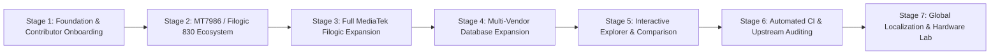

# OpenWrt Router Hardware Knowledge Base — Development Roadmap

This roadmap outlines the phased evolution of this repository from an MT7986 / JIDU6101 installation guide into a globally recognized, multi-vendor, evidence-backed hardware knowledge base for OpenWrt-compatible routers, switches, and embedded network platforms.

---

## Roadmap Overview

---

## Detailed Stages

### Stage 1: Foundation & Contributor Onboarding
**Focus:** Establish documentation protocols, data standards, and contributor infrastructure.  
**Status:** Completed  
**Milestones & Deliverables:**
- [x] Standardized evidentiary taxonomy in `AGENT.md` (no unverified specs or fabricated claims).
- [x] Machine-readable JSON Schemas for devices (`data/schemas/device.schema.json`) and chipsets (`data/schemas/chipset.schema.json`).
- [x] 10 structured GitHub Issue Templates for community submissions, bug reports, and hardware verifications.
- [x] Comprehensive contributor onboarding suite: `FIRST-TIME-CONTRIBUTORS.md`, `docs/contributor-handbook.md`, `docs/hardware-testing-guide.md`, and `docs/documentation-style-guide.md`.
- [x] Continuous progress tracking log (`PROGRESS.md`).

---

### Stage 2: Complete MT7986 & Filogic 830 Reference Ecosystem
**Focus:** Exhaustive technical coverage of the MediaTek MT7986 / Filogic 830 SoC and all commercial implementations.  
**Status:** Active / Production Ready  
**Milestones & Deliverables:**
- [x] Verified hardware profile for Arcadyan / Jio JIDU6101 (`6j01`), including SPI-NAND dual-slot layout, MT7531 switch, and sysfs LED control.
- [x] Disambiguation guide for ISP variants (`JIDU6201`, `JIDU6401`, `JIDU6601`, `JIDU6701`).
- [x] Hardware profiles for community flagships: GL.iNet GL-MT6000 (Flint 2), Banana Pi BPI-R3, Asus TUF AX4200, Xiaomi Redmi AX6000, and Mercusys MR90X.
- [x] Real-world multi-WAN failover guide (`docs/networking/multi-wan-failover.md`) featuring mwan3, travelmate, and hardware LED indicators.
- [ ] Direct flash partition dumps and bootloader environment analysis across carrier-locked MT7986 router batches.

---

### Stage 3: Full MediaTek Filogic Family Expansion
**Focus:** Extend architectural coverage across the entire MediaTek Filogic product line.  
**Status:** In Progress  
**Milestones & Deliverables:**
- [x] Filogic 820 (MT7981B) chipset profile and reference devices (GL.iNet GL-MT3000 Beryl AX, Cudy WR3000 v1).
- [x] Filogic 880 (MT7988A) Wi-Fi 7 quad-core 10GbE platform profile and Banana Pi BPI-R4 device record.
- [x] Legacy MT7621A dual-core MIPS platform coverage (TP-Link Archer C6 v3, Ubiquiti ER-X reference).
- [ ] Community profiles for MT7981-based ISP gateways and budget travel routers.
- [ ] Comparative benchmark matrix evaluating MT7621 vs MT7981 vs MT7986 vs MT7988 packet processing engine (PPE) line-rate throughput.

---

### Stage 4: Multi-Vendor Hardware Knowledge Base
**Focus:** Expand coverage to Qualcomm, Broadcom, Rockchip, Realtek, and x86_64 platforms.  
**Status:** Active  
**Milestones & Deliverables:**
- [x] Qualcomm IPQ profiles: IPQ8072A (Hawkeye AX), IPQ6018, and IPQ4019 (Dakota).
- [x] Broadcom BCM4908 profile with explicit documentation of proprietary Broadcom Wi-Fi driver constraints under mainline Linux/OpenWrt.
- [x] Realtek RTL8380M managed switch platform (Distributed Switch Architecture) and Zyxel GS1900-8 device profile.
- [x] Rockchip RK3568 quad-core 2.5G multi-port router profile and FriendlyElec NanoPi R5S device record.
- [x] Intel / AMD x86_64 soft-router platform profile (`intel-x86-64-generic`).
- [ ] Qualcomm IPQ5018 / IPQ5332 (Wi-Fi 7) ecosystem audit.
- [ ] Comprehensive silicon comparison table linking thermal TDP, core architecture, cryptography engines, and DSA support.

---

### Stage 5: Interactive Client-Side Hardware Explorer & Comparison Engine
**Focus:** Deliver a zero-dependency, ultra-fast web interface for discovering and comparing router hardware.  
**Status:** Deployed (`explorer/index.html`) / Ongoing Feature Expansion  
**Milestones & Deliverables:**
- [x] Standalone, zero-dependency browser explorer reading compiled `data/index.json`.
- [x] Real-time faceted search by vendor, model, chipset, Wi-Fi standard, and OpenWrt support status.
- [x] Side-by-side hardware comparison drawer supporting up to 3 simultaneous devices.
- [x] Detailed device modal displaying storage, RAM, Ethernet speeds, flash layouts, recovery methods, and direct source links.
- [ ] Offline PWA (Progressive Web App) caching for emergency network troubleshooting offline.
- [ ] Interactive interactive pinout diagram viewer for serial UART and JTAG headers.

---

### Stage 6: Automated CI Compatibility Auditing & Link Rot Defense
**Focus:** Maintain absolute data integrity, prevent dead links, and sync with upstream OpenWrt changes.  
**Status:** Active Initial CI  
**Milestones & Deliverables:**
- [x] Python index builder (`scripts/build-index.py`) validating JSON schema compliance.
- [x] Zero-dependency automated test runner (`tests/run_tests.py`) testing schema validity, required fields, and index consistency.
- [x] GitHub Actions workflow `.github/workflows/validate-data.yml` for pull request data validation.
- [x] GitHub Actions workflow `.github/workflows/lint-markdown.yml` for markdown link checking.
- [ ] Scheduled daily cron job auditing device upstream OpenWrt download links against OpenWrt snapshot and stable release mirrors.
- [ ] Automated Git commit sync bot notifying when upstream OpenWrt target commits modify device device-tree files (`dts`).

---

### Stage 7: Global Community, Localization & Hardware Lab
**Focus:** Foster an international network of hardware testers, community maintainers, and translated documentation.  
**Status:** Planned  
**Milestones & Deliverables:**
- [ ] Establish regional maintainer pods across Asia-Pacific, Europe, North America, and Latin America.
- [ ] Coordinate with community hardware labs to collect verifiable boot logs, UART traces, and FCC internal photography.
- [ ] Community translation framework for core installation and unbricking guides (Spanish, Chinese, Hindi, German, French).
- [ ] Public hardware submission verification board tracking pending physical device validation.

---

## Tracking Progress

Progress is recorded in real time within [PROGRESS.md](PROGRESS.md). Contributor pull requests and issue submissions align with the stage priorities outlined above.
