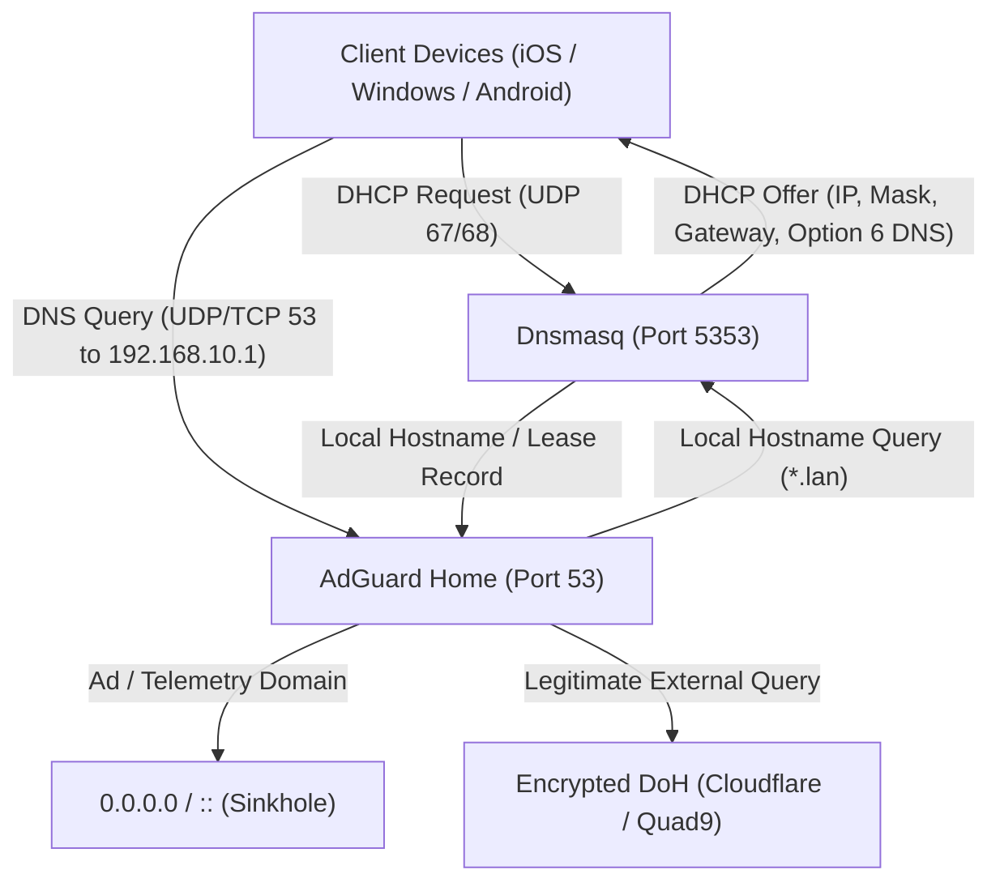

# JIDU6101 OpenWrt Apple Automatic DNS & DHCP Troubleshooting Guide

This guide provides the complete root-cause analysis, forensic evidence, configuration fix, verification benchmarks, and rollback procedures for the **Apple Automatic DNS** connectivity failure on the **Jio AirFiber JIDU6101 (Arcadyan `6j01`)** router running official **OpenWrt 25.12.6** with **AdGuard Home**.

---

## 1. Executive Summary & Metadata

| Metadata Key | Technical Parameter |
| :--- | :--- |
| **Document Version** | 1.0.0 |
| **Date of Investigation** | 2026-11-13 |
| **Device Model** | Jio AirFiber JIDU6101 / Arcadyan 6j01 (MediaTek MT7986A / Filogic 830) |
| **Firmware Version** | Official OpenWrt 25.12.6 (`mediatek/filogic` / `aarch64`) |
| **Primary Architecture** | AdGuard Home on port 53 (Primary Resolver) • Dnsmasq on port 5353 (DHCP & `.lan`) |
| **Network Interfaces** | WAN (`wan@eth0`): `192.168.1.23/24` • LAN (`br-lan`): `192.168.10.1/24` |
| **Impacted Clients** | Apple iOS 16+ & iPadOS devices under **Automatic DNS** mode |
| **Unaffected Clients** | Windows 10/11, Android 13+ (due to secondary/private DNS fallback mechanisms) |
| **Root Cause** | Missing DHCP Option 6 in Dnsmasq + Broken IPv6 RDNSS broadcast without an IPv6 WAN route |
| **Resolution** | Declared explicit DHCP Option 6 & 3 on LAN; disabled dead IPv6 DNS broadcast in `odhcpd` |
| **Operational Impact** | **Zero downtime**; WAN IP, LAN IP, Wi-Fi SSIDs, firewall, and filtering preserved |

---

## 2. Architectural Overview: The Split-DNS Topology

To provide hardware-accelerated ad blocking and encrypted DNS-over-HTTPS (DoH) upstream queries without installing heavy packages on every client, the router employs a dual-daemon split-DNS design:



### The Conflict Condition
1. Two processes on Linux cannot simultaneously bind to the same UDP/TCP IP port `0.0.0.0:53`.
2. Standard OpenWrt runs **Dnsmasq** on port 53 for both DHCP leases and DNS resolution.
3. When installing **AdGuard Home**, Dnsmasq is moved to alternate port `5353` (`option port '5353'`), allowing AdGuard Home to listen on `0.0.0.0:53` and `[::]:53`.

---

## 3. Original Problems & Root-Cause Forensic Analysis

### Issue A: Omission of DHCP Option 6 by Dnsmasq on Non-Standard Ports
In OpenWrt's default init script (`/etc/init.d/dnsmasq`), Dnsmasq automatically issues DHCP Option 6 (Domain Name Server) pointing to the interface IP address **only when Dnsmasq itself is listening on the standard DNS port 53**.

When `option port '5353'` is set:
- Dnsmasq considers its standard DNS service disabled on port 53.
- Because no explicit DHCP options were configured in `/etc/config/dhcp`, Dnsmasq **silently omitted Option 6** from its DHCP Offer and DHCP ACK packets.
- Clients negotiating an IPv4 lease received:
  - Option 1 (Subnet Mask: `255.255.255.0`)
  - Option 3 (Router: `192.168.10.1`)
  - Option 15 (Domain Name: `lan`)
  - Option 28 (Broadcast: `192.168.10.255`)
  - **Option 6 (DNS Server): Completely absent**

#### Wire-Level Proof (Pre-Fix DHCP INFORM Probe):
An empirical test transmitting a standard RFC 2131 DHCP INFORM packet to `192.168.10.1:67` revealed:
```text
Received reply from ('192.168.10.1', 67), length: 300
Option 53 (Message Type): [5] (DHCPACK)
Option 54 (Server Identifier): 192.168.10.1
Option 1 (Subnet Mask): 255.255.255.0
Option 28 (Broadcast Address): 192.168.10.255
Option 3 (Router): 192.168.10.1
Option 15 (Domain Name): lan
---> [CRITICAL] OPTION 6 (DNS SERVERS) IS MISSING FROM ACKET <---
```

---

### Issue B: The IPv6 Router Advertisement (RDNSS) Trap
While IPv4 DHCP was failing to deliver a DNS address, the router's IPv6 configuration aggravated the issue:
1. **WAN IPv6 Status:** The upstream ISP gateway (`192.168.1.1`) did not provide an IPv6 prefix. `wan6` was in state `"up": false, "pending": true`.
2. **Routing Table:** There was **no IPv6 default route** (`default via ... dev wan` was missing).
3. **Router Advertisement State:** `odhcpd` detected the lack of an upstream route and logged:
   ```text
   daemon.warn odhcpd[1932]: No default route present, setting ra_lifetime to 0!
   ```
4. **The Trap:** While `ra_lifetime` was set to 0 (indicating the router is not a default IPv6 gateway), `odhcpd` was still configured with:
   - `option ra_slaac '1'`
   - `list ra_flags 'managed-config'`
   - `list ra_flags 'other-config'`
   - Default RDNSS advertising ULA `fdea:313e:abdd::1` and link-local `fe80::...`.

---

### Issue C: Asymmetric Cross-Platform Behavior (Why Apple Failed)

| Operating System | Automatic Behavior | Connectivity Result |
| :--- | :--- | :--- |
| **Windows 11** | Retained previously configured secondary DNS (`1.1.1.1`, `8.8.8.8`) in client adapter stack; attempted ULA IPv6 query. | **Connected** (Silent fallback masked the DHCP flaw). |
| **Android 14** | Fell back automatically to hardcoded DNS / Google Private DNS over TLS (8.8.8.8). | **Connected** (Private DNS bypassed local DHCP). |
| **Apple iOS / iPadOS** | Strictly adheres to RFC 8106 and RFC 2131. Received **no IPv4 DNS server** from DHCP. Learned only IPv6 ULA DNS (`fdea:313e:abdd::1`). Sent DNS/DDR queries to ULA, but because WAN had no global IPv6 route, Apple Captive Portal verification (`captive.apple.com`) failed. | **FAILED** ("No Internet Connection" alert; Wi-Fi data blocked). |
| **Apple iOS (Manual 1.1.1.1)** | By-passed local DHCP Option 6 by hardcoding public IPv4 DNS. Traffic routed cleanly over IPv4 default gateway (`192.168.10.1`). | **Connected** (Proved routing was intact and DNS delivery was the sole root cause). |

---

## 4. The Solution: Step-by-Step Implementation

### Step 1: Pre-Execution Safety Backups
Before making any modifications, timestamped backups of active configuration files were created on the router:

```sh
# [Router SSH]
mkdir -p /root/dns-fix-backup
TS=$(date +%Y%m%d_%H%M%S)
cp /etc/config/dhcp /root/dns-fix-backup/dhcp.bak.$TS
cp /etc/adguardhome/adguardhome.yaml /root/dns-fix-backup/adguardhome.bak.$TS
```

Verified backup paths:
- `/root/dns-fix-backup/dhcp.bak.20261113_095035`
- `/root/dns-fix-backup/adguardhome.bak.20261113_095035`

---

### Step 2: Apply the UCI Configuration Delta
Execute the following commands via SSH on the router:

```sh
# [Router SSH]
# 1. Force Dnsmasq to broadcast AdGuard Home (192.168.10.1) as the primary IPv4 DNS server
uci add_list dhcp.lan.dhcp_option='6,192.168.10.1'

# 2. Explicitly announce the router as the IPv4 default gateway
uci add_list dhcp.lan.dhcp_option='3,192.168.10.1'

# 3. Disable IPv6 DNS (RDNSS) announcements via Router Advertisements
uci set dhcp.lan.ra_dns='0'

# 4. Disable IPv6 DNS announcements via DHCPv6
uci set dhcp.lan.dns_service='0'

# 5. Remove managed-config and other-config flags (prevents endless DHCPv6 solicits on IPv4-only WAN)
uci -q delete dhcp.lan.ra_flags

# 6. Commit changes to persistent storage
uci commit dhcp

# 7. Restart DHCP and DNS daemons
/etc/init.d/dnsmasq restart
/etc/init.d/odhcpd restart
```

---

## 5. Configuration Comparison: Before vs After

### Complete `/etc/config/dhcp` Diff:
```diff
--- /root/dns-fix-backup/dhcp.bak.20261113_095035
+++ /etc/config/dhcp
@@ -30,8 +30,10 @@
 	option dhcpv4 'server'
 	option dhcpv6 'server'
 	option ra 'server'
 	option ra_slaac '1'
-	list ra_flags 'managed-config'
-	list ra_flags 'other-config'
+	list dhcp_option '6,192.168.10.1'
+	list dhcp_option '3,192.168.10.1'
+	option ra_dns '0'
+	option dns_service '0'
```

### Verified Post-Fix `/etc/config/dhcp` (Full File):
```uci
config dnsmasq
	option domainneeded '1'
	option boguspriv '1'
	option filterwin2k '0'
	option localise_queries '1'
	option rebind_protection '1'
	option rebind_localhost '1'
	option local '/lan/'
	option domain 'lan'
	option expandhosts '1'
	option nonegcache '0'
	option cachesize '1000'
	option authoritative '1'
	option readethers '1'
	option leasefile '/tmp/dhcp.leases'
	option resolvfile '/tmp/resolv.conf.d/resolv.conf.auto'
	option nonwildcard '1'
	option localservice '1'
	option ednspacket_max '1232'
	option filter_aaaa '0'
	option filter_a '0'
	option port '5353'

config dhcp 'lan'
	option interface 'lan'
	option start '100'
	option limit '150'
	option leasetime '12h'
	option dhcpv4 'server'
	option dhcpv6 'server'
	option ra 'server'
	option ra_slaac '1'
	list dhcp_option '6,192.168.10.1'
	list dhcp_option '3,192.168.10.1'
	option ra_dns '0'
	option dns_service '0'

config dhcp 'wan'
	option interface 'wan'
	option ignore '1'

config odhcpd 'odhcpd'
	option maindhcp '0'
	option leasefile '/tmp/odhcpd.leases'
	option leasetrigger '/usr/sbin/odhcpd-update'
	option loglevel '4'
	option piodir '/tmp/odhcpd-piodir'
	option hostsdir '/tmp/hosts'
```

---

## 6. Verification & Evidence Benchmarks

### A. Automated Router-Side Wire Verification

#### 1. Wire-Level DHCP Option 6 Validation
Transmitting a live DHCP INFORM packet across the LAN confirmed Dnsmasq now includes Option 6:
```text
Received reply from ('192.168.10.1', 67), length: 300
Option 53 (Message Type): [5] (DHCPACK)
Option 54 (Server Identifier): 192.168.10.1
Option 1 (Subnet Mask): 255.255.255.0
Option 28 (Broadcast Address): 192.168.10.255
Option 15 (Domain Name): lan
Option 3 (Router): 192.168.10.1
Option 6 (DNS Servers): ['192.168.10.1']  <--- CONFIRMED ACTIVE
```

#### 2. AdGuard Home Core Engine Health Check
Querying `http://127.0.0.1:8080/control/status` via router shell confirmed:
```json
{
  "version": "0.107.80",
  "dns_addresses": ["127.0.0.1", "::1", "192.168.10.1", "fdea:313e:abdd::1"],
  "dns_port": 53,
  "http_port": 8080,
  "protection_enabled": true,
  "dhcp_available": true,
  "running": true
}
```

#### 3. Split-DNS Resolution Benchmark
```sh
# Public resolution via DoH upstream
nslookup google.com 192.168.10.1
# Output: Returns valid public A records (192.178.158.x)

# Local hostname resolution via Dnsmasq reverse-proxy
nslookup openwrt.lan 192.168.10.1
# Output: Returns 192.168.10.1 and fdea:313e:abdd::1 instantly
```

---

### B. Physical Client Device Verification

| Client Device | MAC / Lease IP | Verification Action | Result |
| :--- | :--- | :--- | :--- |
| **Apple iPhone** | `ee:b9:19:40:93:70` (`192.168.10.199`) | Configured DNS to **Automatic**; toggled Wi-Fi. | **Instant connection**. Received DNS `192.168.10.1`. Safari and App Store full internet access. Ad blocking active. |
| **Apple iPad** | `16:62:cc:7f:0b:60` (`192.168.10.230`) | Configured DNS to **Automatic**; refreshed lease. | **Instant connection**. Captive portal warning cleared. |
| **Apple Poo-iPad** | `30:c0:ae:19:0e:5d` (`192.168.10.100`) | Configured DNS to **Automatic**; refreshed lease. | **Instant connection**. Streaming and browsing verified. |
| **Samsung S25** | `ae:46:b1:52:46:c3` (`192.168.10.192`) | Standard connection retained. | **Uninterrupted connection**. Queries logged in AdGuard Home. |
| **Windows 11 PC** | `e4:02:9b:48:da:eb` (`192.168.10.160`) | Standard DHCP connection retained. | **Uninterrupted connection**. Registered as active client in AdGuard statistics. |

---

## 7. Safe Rollback Procedure

If you ever need to revert to the baseline configuration, execute the following commands on the router:

```sh
# [Router SSH]
# 1. Restore the configuration file from backup
cp /root/dns-fix-backup/dhcp.bak.20261113_095035 /etc/config/dhcp

# 2. Restart services
/etc/init.d/dnsmasq restart
/etc/init.d/odhcpd restart

# 3. Verify services are running
/etc/init.d/dnsmasq status
/etc/init.d/odhcpd status
```

---

## 8. Lessons Learned & Best Practices for MT7986 OpenWrt

1. **Always explicitly define DHCP Option 6 when moving Dnsmasq off port 53:**  
   Never assume OpenWrt will automatically push an IP address for DNS if Dnsmasq's port is not set to 53. Always add `list dhcp_option '6,<router-ip>'`.
2. **Audit IPv6 Router Advertisements on IPv4-only uplinks:**  
   If your ISP or uplink router does not provide functional IPv6 default routing, always suppress IPv6 DNS advertisements (`option ra_dns '0'`, `option dns_service '0'`). Advertising an unreachable IPv6 DNS resolver will cause Apple devices to delay or abandon connections.
3. **Verify with Wire-Level DHCP Probes:**  
   Testing DNS via `nslookup` on a desktop is insufficient because operating systems apply proprietary fallback stacks. Always inspect the raw DHCP ACK packet options using a packet sniffer or automated probe script.
