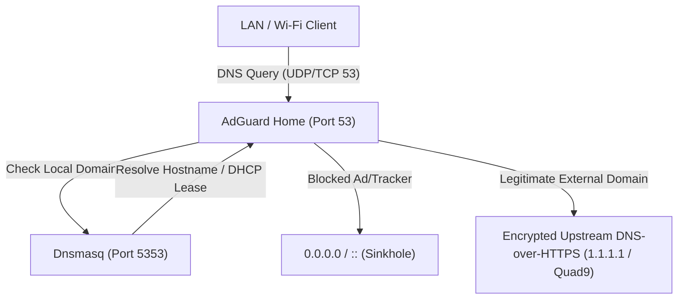

# AdGuard Home DNS & Privacy Architecture

This guide explains how to install, configure, and operate **AdGuard Home** directly on OpenWrt running on MediaTek MT7986 hardware.

---

## 1. Architectural Overview: Port 53 Re-alignment

In standard OpenWrt, **Dnsmasq** handles both local DHCP leases and DNS resolution on port 53. To implement network-wide ad-blocking and encrypted upstream DNS with AdGuard Home, we re-align the DNS pipeline:



### The Conflict & Solution:
1. Two services cannot bind to port 53 simultaneously.
2. Dnsmasq is moved to alternate port **5353** (`option port '5353'`), where it continues handling DHCP IP allocation and local `.lan` hostname resolution.
3. AdGuard Home binds to **`0.0.0.0:53`**, serving as the primary network resolver.
4. AdGuard Home forwards local domain queries (`[/lan/]127.0.0.1:5353`) to Dnsmasq, maintaining local device name resolution seamlessly.

---

## 2. Step-by-Step Installation & Configuration

### Step 2.1: Re-align Dnsmasq to Port 5353 & Announce DHCP Option 6
When Dnsmasq is moved off standard port 53, OpenWrt **stops advertising DHCP Option 6 (DNS server)** automatically. You must explicitly announce your router's LAN IP as Option 6 and suppress unreachable IPv6 DNS announcements if your WAN connection is IPv4-only:

```sh
# [Router SSH]
# 1. Re-align Dnsmasq to port 5353
uci set dhcp.@dnsmasq[0].port='5353'

# 2. Explicitly announce AdGuard Home (router LAN IP) as DHCP Option 6
# (Replace 192.168.1.1 with your actual LAN IP, e.g. 192.168.10.1)
uci add_list dhcp.lan.dhcp_option='6,192.168.1.1'
uci add_list dhcp.lan.dhcp_option='3,192.168.1.1'

# 3. If WAN is IPv4-only, prevent odhcpd from advertising unroutable IPv6 DNS
uci set dhcp.lan.ra_dns='0'
uci set dhcp.lan.dns_service='0'
uci -q delete dhcp.lan.ra_flags

# 4. Commit and restart daemons
uci commit dhcp
/etc/init.d/dnsmasq restart
/etc/init.d/odhcpd restart
```

> [!IMPORTANT]
> **Mandatory for Apple Devices (iOS / iPadOS):**
> Apple devices strictly enforce RFC 2131 and RFC 8106. If Option 6 is missing and IPv6 RA advertises an unreachable ULA DNS server, Apple devices will report "No Internet Connection" under **Automatic DNS**. See the comprehensive [Apple Automatic DNS Troubleshooting Guide](DNS-TROUBLESHOOTING.md) for full forensic analysis and verification steps.

### Step 2.2: Install AdGuard Home
```sh
# [Router SSH]
opkg update
opkg install adguardhome
```

### Step 2.3: Initial Setup Wizard
1. Open your web browser to:
   `http://192.168.1.1:3000` (initial wizard port).
2. Configure Administration Web Interface on port `8080`.
3. Configure DNS Server to listen on **All Interfaces** on port `53`.
4. Set an administrative username and strong password.

---

## 3. Configuring Upstream DNS & Local Domain Forwarding

Inside the AdGuard Home Web Interface (**Settings** → **DNS Settings**):

### Upstream DNS Servers:
Add privacy-respecting, encrypted DNS-over-HTTPS (DoH) providers:
```text
https://1.1.1.1/dns-query
https://1.0.0.1/dns-query
https://149.112.112.112/dns-query
```

### Private Reverse DNS & Local Domain Resolution:
Under **Private reverse DNS servers**, enter:
```text
127.0.0.1:5353
```
Under **Upstream DNS servers**, add local routing rules:
```text
[/lan/]127.0.0.1:5353
[/168.192.in-addr.arpa/]127.0.0.1:5353
```
This ensures local router hostnames (e.g. `openwrt.lan`) resolve instantly without leaking internal queries to the internet.

### Enable DNSSEC:
Check **Enable DNSSEC** to authenticate responses cryptographically and protect against DNS cache poisoning.

---

## 4. Recommended Filter Blocklists

Under **Filters** → **DNS Blocklists**, enable high-quality community curated lists:
- **AdGuard DNS Filter**: Standard comprehensive blocking list.
- **HaGeZi's DNS Blocklists (Pro)**: High-efficiency, zero-false-positive list optimized for home networks.

---

## 5. Verification

From your host computer:

```sh
# 1. Test local hostname resolution
nslookup openwrt.lan 192.168.1.1

# 2. Test ad domain blocking (should return 0.0.0.0)
nslookup doubleclick.net 192.168.1.1

# 3. Test external domain resolution
nslookup google.com 192.168.1.1
```
All queries should resolve in less than 25 ms, with blocked ad domains sinkholed in under 1 ms.
