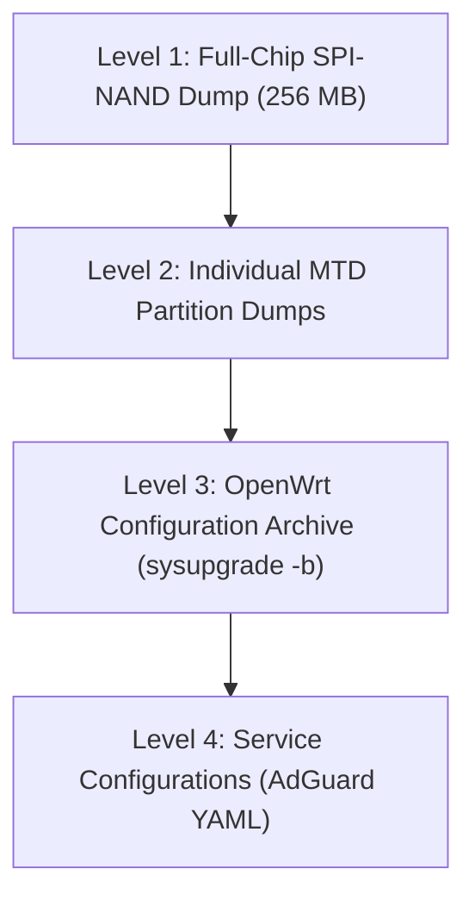

# Backup, Verification & Restoration Guide

A comprehensive backup strategy is essential when experimenting with custom router firmware. This document details backup methodologies, integrity verification, and restoration workflows.

---

## 1. Backup Hierarchy Overview



### 1. Level 1: Full-Chip SPI-NAND Dump (256 MB)
- **Scope**: Complete binary image of all 268,435,456 bytes.
- **Purpose**: Emergency disaster recovery using an external hardware programmer (CH341A / T48) in the event of an unbootable bootloader corruption.

### 2. Level 2: Individual MTD Partition Dumps
- **Scope**: Discrete backups of all flash partitions:
  - `BL2` (Secondary Bootloader)
  - `u-boot-env` (U-Boot environment variables)
  - `Factory` (Wi-Fi calibration and MAC address data)
  - `FIP` (U-Boot BL33 binary)
  - `ubi` / `ubi_backup` (Firmware rootfs and kernel)
  - `MFG` (Hardware manufacturing fingerprints)
- **Purpose**: Software-level restoration of corrupted calibration or bootloader parameters.

### 3. Level 3: OpenWrt Configuration Archive
- **Scope**: User configuration files in `/etc/config/`, custom scripts, and authorized SSH keys.
- **Purpose**: Instant configuration migration or recovery following a sysupgrade.

---

## 2. Creating Backups via Router SSH

### Creating an OpenWrt Configuration Backup
```sh
# [Router SSH]
sysupgrade -b /tmp/backup-$(date +%F).tar.gz
```
Download the generated `.tar.gz` archive to your host machine via SCP:
```powershell
# [Host Terminal]
scp -O root@192.168.1.1:/tmp/backup-*.tar.gz .\
```

### Backing up AdGuard Home Configuration
```sh
# [Router SSH]
tar -czf /tmp/adguardhome-backup.tar.gz /etc/adguardhome.yaml
```

---

## 3. Backup Integrity Verification

Always generate and check cryptographic hashes immediately after creating a backup:

```powershell
# [Host Terminal]
Get-FileHash -Algorithm SHA256 .\backup-*.tar.gz
```

Verify that archive file sizes match expected sizes and archives extract without corruption:
```sh
tar -tzf backup-*.tar.gz > /dev/null && echo "Archive Integrity Verified"
```

---

## 4. Safe Storage & Public Distribution Rules

> [!CAUTION]
> **NEVER upload raw router partition dumps, full-chip dumps, or configuration archives to public repositories.**
> - Vendor `Factory` and `MFG` partitions contain unique hardware MAC addresses, serial numbers, and cryptographic keys.
> - Configuration archives may contain Wi-Fi pre-shared keys, administrator passwords, and network tokens.
> - Store backups on multiple secure offline drives (e.g. encrypted USB drives).
