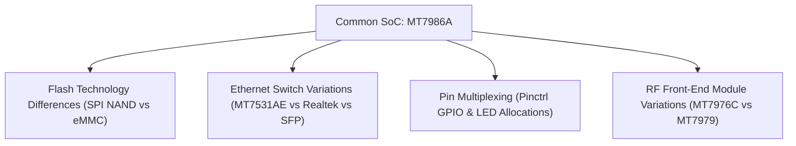

# Hardware Compatibility & Cross-Flashing Notes

This document provides in-depth technical analysis of hardware variations across the MediaTek MT7986 (Filogic 830) router ecosystem and details why firmware images are not interchangeable between vendors.

---

## 1. The Cross-Flashing Hazard Explained

Although multiple routers utilize the MediaTek MT7986A processor, an OpenWrt binary built for one model will almost certainly **brick or render unbootable** a different model if flashed directly.

### Key Hardware Variation Dimensions:



---

## 2. Flash Technology & Partition Differences

| Router Platform | Primary Flash Media | Capacity | Storage Subsystem | Partition Layout Strategy |
| :--- | :---: | :---: | :---: | :--- |
| **JIDU6101 (`6j01`)** | SPI-NAND (Winbond) | 256 MiB | MTD / UBI | Dual-slot UBI (`mtd5` and `mtd6`) with U-Boot environment on volume. |
| **GL.iNet GL-MT6000** | eMMC Flash | 8 GiB | MMC Block (`/dev/mmcblk0`) | GPT partition table with ext4/squashfs overlay. |
| **Banana Pi BPI-R3** | Dual: eMMC + SPI NAND | MicroSD / eMMC | Switchable via DIP switches | Multi-boot bootloader targets. |
| **Asus TUF-AX4200** | SPI-NAND | 256 MiB | MTD / UBI | Proprietary Asus bootloader header format (TRX / UBI). |

> [!CAUTION]
> Flashing an eMMC image to an SPI-NAND device (or vice versa) will corrupt partition tables and destroy the secondary bootloader (BL2).

---

## 3. Ethernet Switch & DSA Interface Mapping

- **JIDU6101**: Integrates a MediaTek **MT7531AE** switch chip connected over GMAC1 (HSGMII at 2.5 Gbps), with physical switch ports `lan1` through `lan4` exposed via Linux DSA.
- **Banana Pi BPI-R3**: Features dual 2.5 Gbps SFP+ cages connected to GMAC1 and GMAC2, alongside discrete GbE PHYs.
- **GL.iNet GL-MT6000**: Features dual 2.5 GbE ports (one WAN, one LAN) alongside four 1 GbE LAN ports driven by distinct PHY drivers.

An incorrect device tree compiled into the kernel will map Ethernet PHY registers incorrectly, leaving the router network ports dark and unreachable over IP.

---

## 4. Pre-Flashing Hardware Audit Checklist

Before attempting to flash an unverified MT7986 router:
1. Connect via root SSH or serial UART on the stock firmware.
2. Inspect the CPU and architecture:
   ```sh
   cat /proc/cpuinfo
   uname -m
   ```
3. Inspect flash partitions and geometry:
   ```sh
   cat /proc/mtd
   ```
4. Verify GPIO pin assignments and switch model from the stock device tree:
   ```sh
   ls /sys/firmware/devicetree/base/
   ```
5. Confirm that the OpenWrt profile name strictly matches the verified hardware identity.
