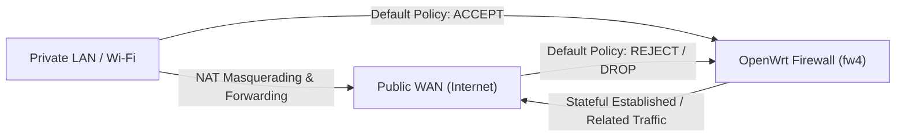

# Firewall Architecture & Network Security Hardening

OpenWrt 25.12 utilizes **Firewall4 (`fw4`)**, an nftables-based packet filtering framework replacing legacy iptables. This document outlines baseline firewall policies, hardware acceleration integration, and perimeter defense configurations.

---

## 1. Default Perimeter Security Policies

The default OpenWrt firewall architecture enforces strict stateful zone boundaries:



### Zone Rules:
- **WAN Input**: `REJECT` (or `DROP`). Unsolicited incoming packets from the internet are immediately discarded.
- **WAN Forward**: `REJECT`. Inbound internet connections cannot route to private LAN devices without explicit port forwarding rules.
- **LAN Input / Forward**: `ACCEPT`. Internal network clients can communicate with the router and initiate outbound connections.

---

## 2. Hardware & Software Flow Offloading

The MediaTek MT7986 features a hardware **Packet Processing Engine (PPE)** capable of multi-gigabit line-rate routing with near-zero CPU overhead.

### Enabling Flow Offloading in `/etc/config/firewall`:
```sh
# [Router SSH]
uci set firewall.@defaults[0].flow_offloading='1'
uci set firewall.@defaults[0].flow_offloading_hw='1'
uci commit firewall
/etc/init.d/firewall restart
```

### Verifying Flow Offload in nftables:
```sh
nft list chain inet fw4 forward | grep "flow add"
```
You should observe the active nftables entry:
`meta l4proto { tcp, udp } flow add @ft`
With flow offloading active, established network streams bypass kernel software routing, reducing CPU usage to less than 2% during heavy throughput.

---

## 3. Perimeter Hardening Rules

### Rule 1: Never Expose Administrative Ports to WAN
Verify that administrative services (LuCI web interface on ports 80/443, SSH on port 22, and AdGuard Home on port 8080) are strictly bound to the LAN interface:

```sh
# Verify no open WAN listening ports via netstat
netstat -tulpn | grep -E '(80|443|22|8080)'
```

### Rule 2: Universal Plug and Play (UPnP) Caution
UPnP (`miniupnpd`) allows internal software (e.g. game consoles, torrent clients) to open incoming firewall ports automatically without administrator confirmation. In high-security environments, UPnP should remain uninstalled or disabled.

### Rule 3: SYN Flood Protection
Ensure SYN flood protection is active in `/etc/config/firewall`:
```uci
config defaults
	option syn_flood '1'
```
This protects the router connection tracking table against denial-of-service attempts.
