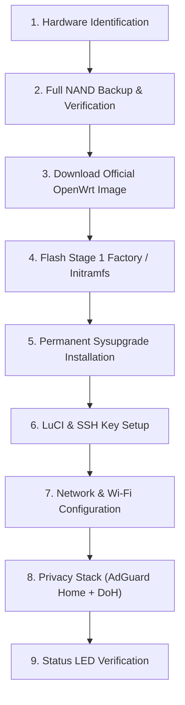

# Getting Started with OpenWrt on MediaTek MT7986

This guide introduces the MediaTek MT7986 (Filogic 830) platform, prerequisites, workflow phases, and initial safety steps required before transitioning to official OpenWrt firmware.

## 1. What is the MT7986 / Filogic 830?

The MediaTek MT7986 (marketed as Filogic 830) is a high-performance system-on-chip (SoC) specifically architected for modern Wi-Fi 6 (802.11ax) routers, gateways, and mesh nodes.

### Key Specifications:
- **CPU**: Quad-Core ARM Cortex-A53 up to 2.0 GHz (64-bit `aarch64`).
- **Network Acceleration**: Dual 2.5 Gbps SGMII/HSGMII Ethernet interfaces with hardware packet offloading (PPE / Packet Processing Engine).
- **Wi-Fi Subsystem**: Direct PCIe / AXI integration with MT7976C / MT7975N RF companion chips delivering up to 4x4 2.4 GHz and 4x4 5.0 GHz concurrent Wi-Fi 6 streams (AX6000 theoretical aggregate).
- **Operating System Support**: Full upstream support in the official Linux kernel and OpenWrt `mediatek/filogic` target.

---

## 2. Essential Prerequisites

Before attempting any firmware replacement:

1. **Hardware Preparation**:
   - A compatible router (e.g. Jio/Arcadyan JIDU6101 or community equivalent).
   - A computer with an RJ-45 Ethernet port (or USB-to-Ethernet adapter).
   - Cat5e or Cat6 Ethernet cable (avoid Wi-Fi during firmware operations).
   - Stable uninterruptible power supply (UPS) during the flashing sequence.

2. **Software Tools**:
   - Modern terminal with OpenSSH client (Windows PowerShell, Linux, or macOS).
   - SCP / SFTP client for file transfer.
   - TFTP server (e.g. `tftpd64` on Windows) for recovery contingencies.

3. **Backup Obligation**:
   - Never flash custom firmware without taking and verifying a full-chip or full-partition backup of the original vendor firmware. See [Backup & Restore](backup-and-restore.md).

---

## 3. High-Level Migration Workflow

The recommended transition sequence is:

## Next Steps

- Explore the [Supported Devices Matrix](supported-devices.md) to confirm your router's support status.
- Review the [Hardware Overview](hardware-overview.md) to understand the internal architecture.
- Follow the [Firmware Installation Guide](installation.md) when ready to proceed.
