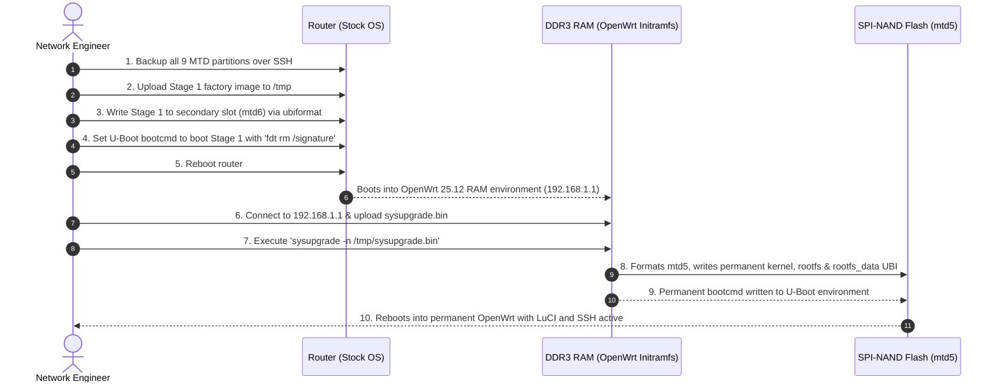

# Firmware Selection & Installation Guide

This document provides a verified, step-by-step installation procedure for installing official community OpenWrt on MediaTek MT7986 routers, using the verified JIDU6101 dual-slot architecture as the primary technical reference.

> [!WARNING]
> Flashing firmware carries inherent risk. Ensure you have verified full-chip NAND partition dumps before proceeding. Do not power off or disconnect the Ethernet cable during the flashing process.

---

## 1. Image Identification & Verification

### Step 1.1: Identify Device Profile
Confirm your router matches the audited hardware:
- Model: JIDU6101 (Board ID: `6j01`)
- Target: `mediatek/filogic`
- Profile: `jiorouter_ax6000-jidu6101`

### Step 1.2: Download Official OpenWrt Images
Two files are required:
1. **Stage 1 (Factory / Ramdisk Image)**:
   - Filename pattern: `openwrt-*-mediatek-filogic-*-factory.ubi` (or `-initramfs-recovery.bin`)
2. **Stage 2 (Permanent Sysupgrade Image)**:
   - Filename pattern: `openwrt-25.12.6-mediatek-filogic-jiorouter_ax6000-jidu6101-squashfs-sysupgrade.bin`

### Step 1.3: Verify SHA256 Checksums
On your local computer (Windows PowerShell / Linux Terminal):

```powershell
# Windows PowerShell
Get-FileHash -Algorithm SHA256 .\openwrt-*-sysupgrade.bin
```

Compare the calculated hash against the official OpenWrt `sha256sums` manifest file. Do not proceed if the hash does not match.

---

## 2. Bootloader Signature Architecture

Stock vendor firmware on MT7986 routers frequently implements FIT (Flattened Image Tree) RSA signature verification.

### How the Bypass Functions:
1. Vendor U-Boot loads the FIT image and inspects the device tree node `/signature`.
2. Upstream OpenWrt community images are signed with standard community keys, not vendor OEM keys.
3. MediaTek U-Boot includes the `fdt` utility command. Executing `fdt rm /signature` in bootloader memory dynamically removes the signature verification requirement before jumping to the kernel entry point (`bootm`).
4. This avoids modifying the read-only bootloader partition (`BL2` / `FIP`) on flash.

---

## 3. Two-Stage Installation Workflow



---

## 4. Step-by-Step Installation Execution

### Stage 1: Staging Factory Image into Inactive Slot

From your host computer, upload the Stage 1 image:

```powershell
# [Host Terminal]
scp -O .\openwrt-factory.ubi root@<ROUTER_IP>:/tmp/jidu-factory.ubi
```

On the router SSH terminal:

```sh
# [Router SSH]
# 1. Format the secondary slot (mtd6) and write the image
ubiformat /dev/mtd6 -y -f /tmp/jidu-factory.ubi

# 2. Configure U-Boot environment for Stage 1 boot
fw_setenv bootcmd "ubi detach; ubi part ubi2; ubi read 46000000 kernel; fdt addr \$(fdtcontroladdr); fdt rm /signature; bootm 0x46000000"
fw_setenv dual_boot.slot_0_invalid 1
fw_setenv dual_boot.slot_1_invalid 1

# 3. Reboot the router
sync
reboot
```

---

### Stage 2: Permanent Sysupgrade Installation

After the router reboots, it will bring up OpenWrt in RAM with the default IP `192.168.1.1`.

1. Reconnect your host computer's Ethernet connection.
2. Verify host IP is in the `192.168.1.0/24` subnet (e.g. `192.168.1.100`).
3. Upload the permanent sysupgrade image:

```powershell
# [Host Terminal]
scp -O .\openwrt-25.12.6-mediatek-filogic-jiorouter_ax6000-jidu6101-squashfs-sysupgrade.bin root@192.168.1.1:/tmp/sysupgrade.bin
```

4. Connect via SSH and trigger the permanent sysupgrade:

```sh
# [Router SSH]
ssh root@192.168.1.1

# Execute sysupgrade without preserving RAM config (-n)
sysupgrade -n /tmp/sysupgrade.bin
```

During this step, the OpenWrt platform script:
- Erases and formats `mtd5` (`ubi`).
- Creates permanent UBI volumes: `u-boot-env`, `kernel`, `rootfs`, and persistent `rootfs_data` (UBIFS overlay).
- Updates the permanent U-Boot environment with the bootloader bypass command:
  `ubi read 46000000 kernel; fdt addr $(fdtcontroladdr); fdt rm /signature; bootm 0x46000000`
- Reboots into your permanent OpenWrt operating system.

---

## 5. Verification

1. Ping `192.168.1.1` from your host computer.
2. Open your web browser to `http://192.168.1.1` to access the LuCI web interface.
3. Proceed to [First Boot Setup](first-boot-setup.md).
