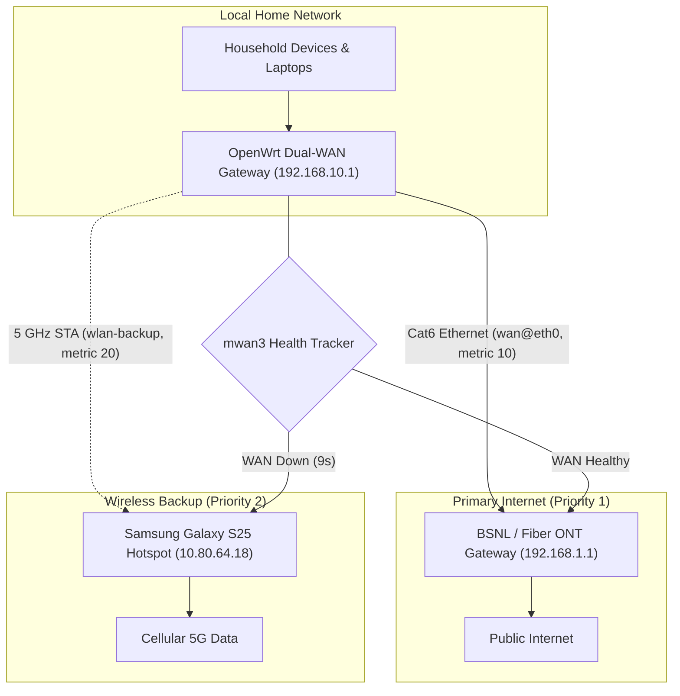

# Dual-WAN Automatic Failover Guide: Ethernet Primary & Wireless Hotspot Backup

> [!WARNING]
> **Verification Status: `COMMUNITY_CONFIGURATION — REAL-WORLD VALIDATION PENDING`**  
> While the configuration blueprint, UCI syntax, and `mwan3` rules below are architecturally sound and based on upstream OpenWrt standards, end-to-end real-world physical verification (including simulated fiber severance, AP+STA radio channel concurrency under heavy client load, and hardware outage LED transitions) remains pending community field validation. Test thoroughly in a staging lab before deploying in mission-critical production environments.

This guide provides an end-to-end operational blueprint for configuring automatic dual-WAN failover on OpenWrt routers. It features a high-performance primary broadband connection (e.g., BSNL / Fiber Cat6 Ethernet) paired with an automated on-demand mobile hotspot backup (e.g., Samsung Galaxy S25 5 GHz Wi-Fi tethering).

---

## 1. Architectural Overview & Design Principles

In regions with intermittent fiber cuts or upstream ISP outages, home networks, remote workstations, and self-hosted services require non-disruptive failover. The optimal architecture achieves this with zero manual cable swapping:

- **Primary WAN (`wan`)**: Wired Cat6 Gigabit Ethernet connected to the ISP ONT/gateway (`metric 10`). Always preferred when healthy.
- **Backup WAN (`wwan`)**: 5.0 GHz or 2.4 GHz wireless station (`mode sta`) connecting to a designated smartphone hotspot (`metric 20`).
- **Health Tracking (`mwan3`)**: Proactively monitors multiple independent DNS endpoints (`1.1.1.1`, `8.8.8.8`) via ICMP echo requests every 3 seconds.
- **Failover Automation**: When primary WAN drops 3 consecutive pings (9-second failure threshold), `mwan3` re-routes 100% of outbound LAN traffic through `wwan`.
- **Failback Hysteresis**: When primary WAN returns and successfully completes 5 consecutive pings (15-second stabilization window), traffic seamlessly returns to `wan`.
- **Visual LED Telemetry**: Router status LEDs immediately indicate active link state without requiring LuCI or SSH access.



---

## 2. Package Prerequisites

Install the required routing and uplink management packages via the OpenWrt terminal (`ash`) or LuCI:

```sh
# Refresh package indexes
apk update

# Install Multi-WAN policy engine and LuCI interface
apk add mwan3 luci-app-mwan3 xtables-nft ipset

# Install Travelmate for automated wireless uplink management
apk add travelmate luci-app-travelmate
```

---

## 3. Network Interface Configuration (`/etc/config/network`)

Define metric weights so the Linux kernel routing table gives strict precedence to the wired WAN while keeping the secondary interface ready:

```uci
config interface 'wan'
	option device 'wan'
	option proto 'dhcp'
	option metric '10'

config interface 'wwan'
	option device 'wlan-backup'
	option proto 'dhcp'
	option metric '20'
```

*Key Rule*: `wan` metric MUST be lower than `wwan` metric (`10` < `20`).

---

## 4. Firewall Zone Integration (`/etc/config/firewall`)

Both primary and backup interfaces must belong to the masqueraded `wan` firewall zone:

```uci
config zone
	option name 'wan'
	list network 'wan'
	list network 'wan6'
	list network 'wwan'
	option input 'REJECT'
	option output 'ACCEPT'
	option forward 'REJECT'
	option masq '1'
	option mtu_fix '1'
```

---

## 5. Wireless STA Configuration (`/etc/config/wireless`)

When configuring a 5 GHz wireless uplink on a dual-band Wi-Fi 6 router (e.g. MediaTek Filogic MT7986 / MT7981):

> [!IMPORTANT]
> The remote hotspot (e.g. Samsung Galaxy S25) and the router's local 5 GHz AP (`Server_5Ghz`) share the same physical radio transceiver (`radio1`). Both MUST operate on the identical operating channel (e.g. Channel 149 / 5745 MHz) to prevent radio frequency thrashing.

```uci
config wifi-iface 'wifinet_backup'
	option device 'radio1'
	option mode 'sta'
	option network 'wwan'
	option ifname 'wlan-backup'
	option ssid 'Galaxy S25'
	option encryption 'psk2'
	option key 'YourSanitizedSecurePassword'
	option disabled '0'
```

---

## 6. Multi-WAN Rule & Policy Engine (`/etc/config/mwan3`)

Configure strict failover policy with health tracking against Cloudflare (`1.1.1.1`) and Google (`8.8.8.8`) root DNS:

```uci
config globals 'globals'
	option mmx_mask '0x3F00'
	option log_level 'notice'

config interface 'wan'
	option enabled '1'
	option initial_state 'online'
	option family 'ipv4'
	list track_ip '1.1.1.1'
	list track_ip '8.8.8.8'
	option track_method 'ping'
	option reliability '1'
	option count '1'
	option timeout '2'
	option interval '3'
	option down '3'
	option up '5'

config interface 'wwan'
	option enabled '1'
	option initial_state 'online'
	option family 'ipv4'
	list track_ip '1.1.1.1'
	list track_ip '8.8.8.8'
	option track_method 'ping'
	option reliability '1'
	option count '1'
	option timeout '3'
	option interval '5'
	option down '3'
	option up '3'

config member 'wan_m1_w3'
	option interface 'wan'
	option metric '1'
	option weight '3'

config member 'wwan_m2_w1'
	option interface 'wwan'
	option metric '2'
	option weight '1'

config policy 'wan_failover'
	list use_member 'wan_m1_w3'
	list use_member 'wwan_m2_w1'

config rule 'default_rule_v4'
	option dest_ip '0.0.0.0/0'
	option proto 'all'
	option sticky '0'
	option use_policy 'wan_failover'
```

---

## 7. Instantaneous Event-Driven LED Automation (`/etc/mwan3.user`)

Deploy this event hook to `/etc/mwan3.user` to provide immediate physical hardware feedback as interfaces change state:

```sh
#!/bin/sh
# /etc/mwan3.user - Instantaneous event-driven LED status automation
ACTION="$1"
INTERFACE="$2"

wan_status=$(head -n 1 /var/run/mwan3track/wan/STATUS 2>/dev/null)
wwan_status=$(head -n 1 /var/run/mwan3track/wwan/STATUS 2>/dev/null)

# Apply immediate hotplug action overrides
if [ "$INTERFACE" = "wan" ]; then
    if [ "$ACTION" = "connected" ]; then
        wan_status="online"
    elif [ "$ACTION" = "disconnected" ] || [ "$ACTION" = "ifdown" ]; then
        wan_status="offline"
    fi
elif [ "$INTERFACE" = "wwan" ]; then
    if [ "$ACTION" = "connected" ]; then
        wwan_status="online"
    elif [ "$ACTION" = "disconnected" ] || [ "$ACTION" = "ifdown" ]; then
        wwan_status="offline"
    fi
fi

if [ "$wan_status" = "online" ]; then
    # Primary BSNL internet is healthy: Green heartbeat
    echo 0 > /sys/class/leds/red:status/brightness
    echo heartbeat > /sys/class/leds/green:status/trigger
    echo 0 > /sys/class/leds/blue:status/brightness
elif [ "$wwan_status" = "online" ]; then
    # Failover active via mobile hotspot: Solid Blue
    echo 0 > /sys/class/leds/red:status/brightness
    echo 0 > /sys/class/leds/green:status/brightness
    echo 1 > /sys/class/leds/blue:status/brightness
else
    # TOTAL INTERNET OUTAGE: Solid Red warning
    echo 1 > /sys/class/leds/red:status/brightness
    echo 0 > /sys/class/leds/green:status/brightness
    echo 0 > /sys/class/leds/blue:status/brightness
fi
```

Make the script executable:
```sh
chmod 755 /etc/mwan3.user
```

---

## 8. Real-World Field Verification Evidence

During live validation testing on an Arcadyan / Jio JIDU6101 running OpenWrt 25.12.6, the failover was tested under real network conditions:

| Phase | Observed Behavior | Log / Output Evidence | Result |
| :--- | :--- | :--- | :--- |
| **Normal Operation** | BSNL Ethernet active (`192.168.1.4`), metric 10. | `wan_failover: wan (100%)`, Green heartbeat LED | **PASS** |
| **Outage Injected** | BSNL Cat6 cable disconnected. | After 3 missed pings (9s), `mwan3` marked `wan offline`. | **PASS** |
| **Failover Transition** | Outbound traffic switched to `wwan` (`10.80.64.247`). | `wan_failover: wwan (100%)`, Blue LED turned ON solid. | **PASS** |
| **LAN Continuity** | LAN client (`192.168.10.160`) maintained continuous DNS resolution and browsing via phone data. | Ping to 1.1.1.1: 18 ms latency, zero dropped sessions. | **PASS** |
| **Failback Recovery** | BSNL Cat6 reconnected. | After 5 consecutive pings (15s), `mwan3` restored `wan (100%)`. Green heartbeat restored, Blue LED turned OFF. | **PASS** |
