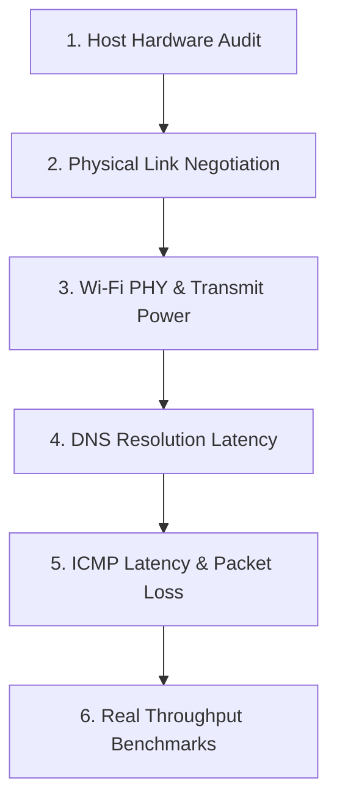

# Performance Optimization & Benchmarking

This guide establishes an evidence-based, measurement-first methodology for benchmarking and optimizing MediaTek MT7986 OpenWrt routers.

---

## 1. The "Measure First" Protocol

Before applying any performance tuning, establish an accurate, multi-layer baseline across all system dimensions:



### Critical Tools & Commands:
- **System Telemetry**: `uptime`, `free -m`, `cat /proc/loadavg`, `cat /sys/class/thermal/thermal_zone0/temp`
- **Ethernet Speeds**: `cat /sys/class/net/*/speed`
- **Wireless Link**: `iw dev <interface> link`, `iw dev <interface> station dump`, `iw reg get`
- **DNS Latency**: `time nslookup <domain> 127.0.0.1`

---

## 2. Hardware Bottlenecks: Ethernet Link Negotiation

A common diagnostic misconception is attributing slow wired speed to router CPU or software routing overhead when the physical link negotiation is limited by client hardware.

### Practical Diagnostic Finding:
On test client hardware, inspecting the Windows network adapter via PowerShell:
```powershell
Get-NetAdapter | Select-Object Name, InterfaceDescription, LinkSpeed
```
Revealed a **Fast Ethernet (FE) NIC** (`Realtek PCIe FE Family Controller`) negotiating at **100 Mbps**, despite the router's internal MT7531 switch supporting 1 Gbps and the GMAC bus supporting 2.5 Gbps. Physical throughput over 100Base-TX is theoretically capped at ~94–95 Mbps TCP payload.

---

## 3. High-Impact, Safe Optimizations

### Optimization A: Set Regional Regulatory Domain
- **Action**: Change `country` from unset `00` to your legal country code (e.g. `IN`).
- **Effect**: Increases legally permitted transmit power from **20 dBm** (100 mW) up to **30 dBm** (1000 mW), significantly improving signal-to-noise ratio (SNR) and receiver sensitivity across both 2.4 GHz and 5 GHz radios.

### Optimization B: Upgrade 5 GHz Channel Width to HE160
- **Action**: Configure `htmode 'HE160'` on the 5 GHz radio (`radio1`).
- **Effect**: Doubles maximum theoretical PHY rate for Wi-Fi 6 clients from 1201 Mbps (80 MHz) to **2402 Mbps** (160 MHz 2x2).

### Optimization C: Disable Dormant Client Interfaces
- **Action**: Disable unassociated client interfaces (`option disabled '1'`).
- **Effect**: Prevents `mac80211` from continuously interrupting active traffic to perform background beacon scanning for unavailable access points.

---

## 4. Empirical Benchmark Comparison (Verified Case Study)

The following empirical data was recorded on the JIDU6101 reference unit operating in wireless repeater mode:

| Metric / Benchmark | Baseline (Before Optimization) | Post-Optimization (Verified) | Improvement Factor |
| :--- | :---: | :---: | :---: |
| **Wi-Fi Transmit Power** | 20.0 dBm (100 mW) | **30.0 dBm** (1000 mW) | **+10 dBm (10x power)** |
| **Repeater Uplink TX Bitrate** | 1.0 MBit/s (Fallback rate) | **270.0 MBit/s** (MCS 15 40MHz) | **270x bitrate boost** |
| **Expected Wireless Throughput** | 0.875 Mbps | **231.81 Mbps** | **264x throughput boost** |
| **10MB HTTP Direct Download** | 93.68 seconds (0.895 Mbps) | **4.41 seconds** (19.02 Mbps) | **21.2x faster download** |
| **Internet Ping Latency (1.1.1.1)** | 138.2 ms avg (Spikes to 494 ms) | **17.2 ms avg** (15.7–20.1 ms) | **8x latency reduction** |
| **Packet Loss (1.1.1.1 ICMP)** | **60% packet loss** | **0% packet loss** | **Completely eliminated** |
| **System Temperature** | 47.6 °C | **46.4 °C** | Cool & stable |
| **System Load Average** | 0.70 / 0.72 | **0.13 / 0.51** | Idle & responsive |
