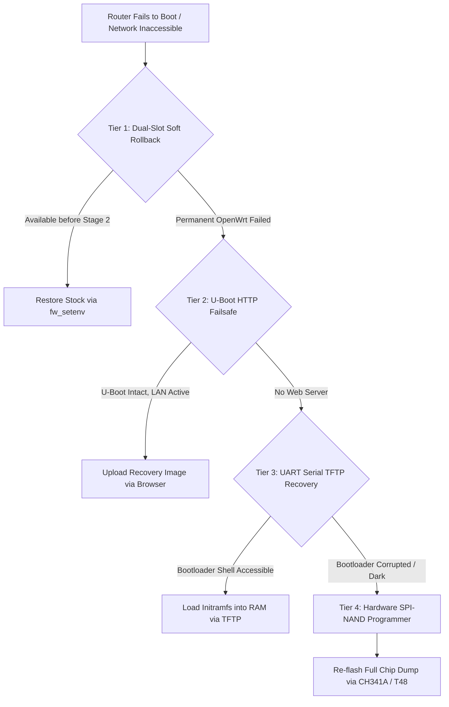

# Router Recovery & Unbricking Guide

This guide establishes a multi-tiered disaster recovery and unbricking hierarchy for MediaTek MT7986 routers, providing verified rescue routes ranging from software rollbacks to hardware SPI-NAND flashing.

---

## 1. Multi-Tier Recovery Hierarchy



---

## 2. Tier 1: Dual-Slot Software Rollback (Pre-Stage 2)

On routers with dual-slot vendor partitions (such as the JIDU6101), Stage 1 only flashes into the secondary inactive slot (`mtd6`), leaving the original stock operating system intact in `mtd5`.

If Stage 1 fails to boot properly:
1. Access the bootloader environment via SSH or serial console.
2. Clear the custom `bootcmd` and re-enable stock boot slots:
   ```sh
   fw_setenv bootcmd
   fw_setenv dual_boot.slot_0_invalid 0
   fw_setenv dual_boot.slot_1_invalid 0
   ```
3. Reboot to immediately resume vendor firmware.

---

## 3. Tier 2: MediaTek U-Boot HTTP Web Failsafe

Upstream MediaTek Filogic U-Boot builds frequently incorporate an embedded HTTP web failsafe server:

1. Connect your computer directly to LAN port 1.
2. Assign a static IP address to your computer:
   - IP: `192.168.1.10`
   - Subnet Mask: `255.255.255.0`
   - Gateway: `192.168.1.1`
3. Power on the router while holding the physical **Reset** button for 10–15 seconds until status LEDs indicate failsafe mode.
4. Navigate to `http://192.168.1.1` in your browser.
5. If the U-Boot failsafe page appears, upload an official OpenWrt `initramfs-recovery.bin` image to restore operation.

---

## 4. Tier 3: Serial Console (UART) TFTP Recovery

If the router does not obtain network connectivity, connect to the internal serial debug header:

### Hardware Requirements:
- USB-to-UART Adapter set strictly to **3.3V TTL** (FTDI FT232RL, CP2102, or CH340).
- Terminal program: PuTTY, Tera Term, or Minicom.
- Serial parameters: `115200 baud, 8 data bits, no parity, 1 stop bit, no flow control`.

### Procedure:
1. Connect adapter `GND` to router `GND`, adapter `RX` to router `TX`, and adapter `TX` to router `RX`. (Do not connect `VCC`).
2. Open terminal and power on the router. Interrupt the boot sequence when prompted to enter the U-Boot shell (`MT7986>`).
3. Launch a TFTP server (e.g. `tftpd64`) on your computer hosting `openwrt-initramfs.bin` at IP `192.168.1.10`.
4. In the U-Boot shell, load the kernel into RAM and execute it:
   ```text
   setenv serverip 192.168.1.10
   setenv ipaddr 192.168.1.1
   tftpboot 0x46000000 openwrt-initramfs.bin
   fdt addr $(fdtcontroladdr)
   fdt rm /signature
   bootm 0x46000000
   ```
5. The router boots into OpenWrt in RAM without writing to flash, allowing you to access SSH at `192.168.1.1` and perform a clean `sysupgrade`.

---

## 5. Tier 4: Hardware SPI-NAND Programmer Recovery

If the bootloader itself is corrupted (device is completely unresponsive with no serial output):

### Tools Required:
- External SPI-NAND Flash Programmer (e.g. XGecu T48, TL866II Plus, or CH341A with 1.8V/3.3V SPI NAND software support).
- Full 256 MB chip backup created before initial flashing (`mtd0_spi0.1.bin`).

### Procedure:
1. De-solder the SPI-NAND flash chip (or connect high-precision test clips if in-circuit programming is supported).
2. Place the chip in the programmer socket and verify chip ID detection (Winbond `W25N02KV` or equivalent).
3. Erase the chip and flash the verified 256 MB backup image.
4. Verify checksum against the original backup manifest.
5. Solder the chip back onto the PCB. The device will boot into original factory state.
